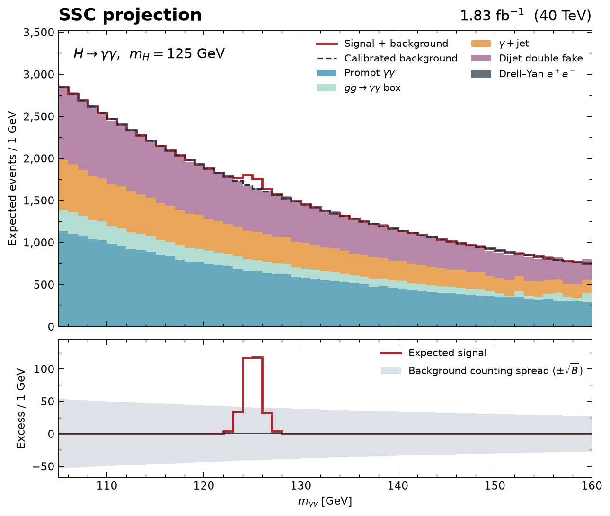
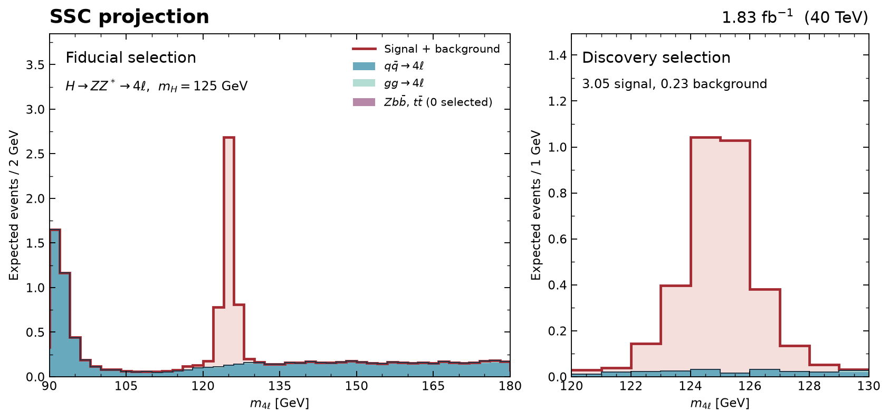
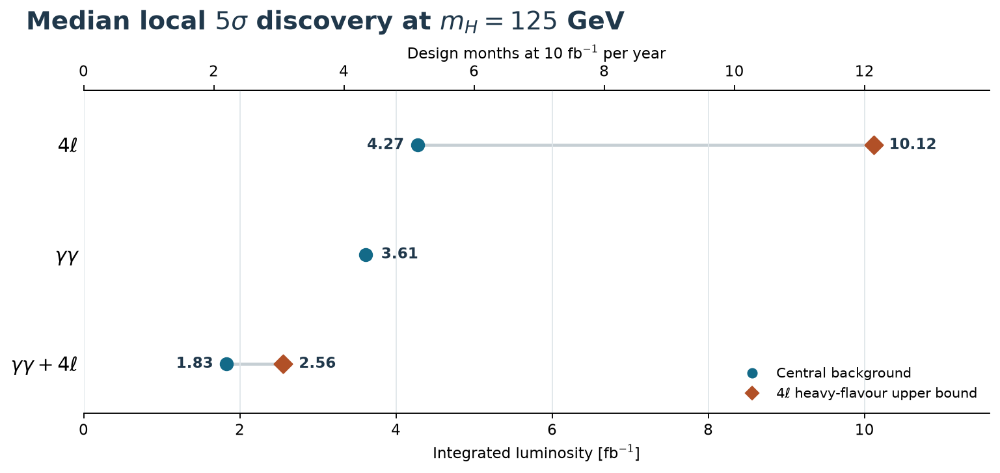
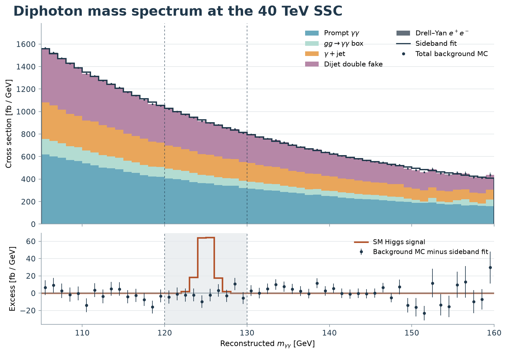
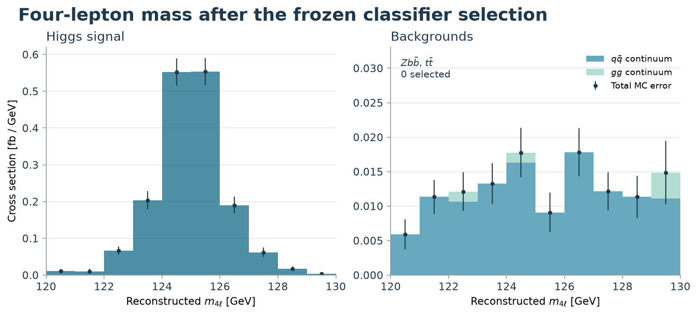
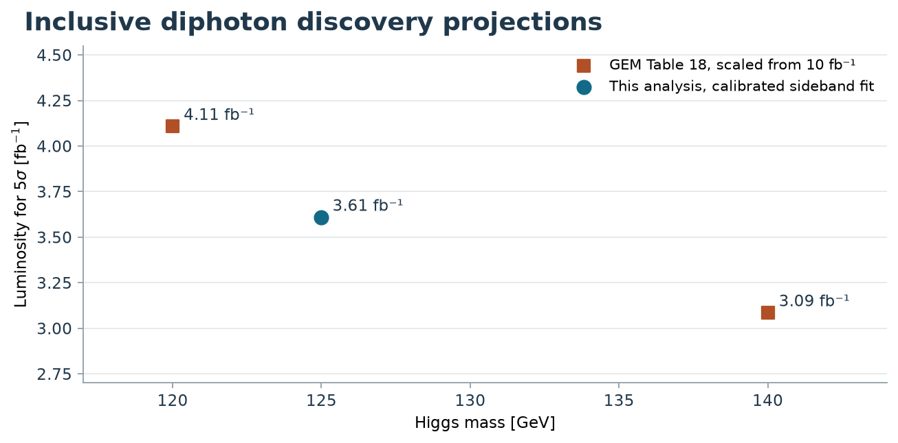

# When could the SSC have discovered a 125 GeV Higgs?

At a 40 TeV proton–proton SSC, the median local 5σ threshold for the Standard Model Higgs is **1.83 fb⁻¹ in diphotons and four leptons combined**, or **2.20 months** at the design delivery of 10 fb⁻¹ per year. With the four-lepton heavy-flavour background at its joint 95% simulation upper bound, the combined threshold is **2.56 fb⁻¹**, or **3.07 months**. The diphoton-only estimate is **3.61 fb⁻¹**, or **4.33 months**.

These are expected first crossings at a fixed Higgs mass. At the quoted luminosity, the modeled signal has a 50% chance of passing a one-sided local 5σ test. Months assume design delivery from the start. A search across unknown masses, detector commissioning or a different luminosity history would change the interpretation.

## What one experiment would see

Both mass spectra below show expected numbers of events in one detector at the **same 1.83 fb⁻¹**. The diphoton peak and the handful of clean four-lepton candidates together give a 50% probability of local 5σ at 125 GeV. With **3.26 fb⁻¹ (3.91 design months)** the probability rises to 90%. Using the four-lepton heavy-flavour upper bound gives 90% at **4.40 fb⁻¹ (5.28 months)**. Each probability refers to a test at a specified exposure. [Probability versus luminosity (PDF)](published/discovery-probability.pdf) · [Numerical curve](published/discovery_probability.csv)



**Diphotons.** The upper panel shows the five simulated background components, the calibrated background used in the likelihood, and the signal plus background. The lower panel subtracts the calibrated background from the expected total, exposing the 125 GeV peak. The band shows one standard deviation of Poisson counting fluctuations about a fixed background in each bin. The finite-MC background uncertainty enters the discovery fit separately. Between 120 and 130 GeV the model predicts **309 signal events over 16,737 background events**. The discovery fit uses the full 105–160 GeV spectrum. [Diphoton figure (PDF)](published/discovery-diphoton.pdf) · [ATLAS discovery paper, Fig. 4](https://arxiv.org/html/1207.7214#S5.F4)



**Four leptons.** The wider spectrum shows the 4e, 4μ and 2e2μ candidates passing the SSC lepton, isolation, pairing and trigger requirements. The continuum samples were generated over 90–180 GeV in hard four-lepton mass, so migration at the ends of the displayed range depends on this generation cut. The second panel shows the independent test sample after the final classifier selection in 120–130 GeV. It contributes **3.05 signal events over 0.23 continuum events** to the combined likelihood. Three million heavy-flavour source events gave zero selected candidates. Their joint upper bound constrains the total yield and supplies no measured mass distribution. [Four-lepton figure (PDF)](published/discovery-fourlepton.pdf) · [CMS discovery paper, Figs. 3–4](https://cms-results.web.cern.ch/cms-results/public-results/publications/HIG-12-028/index.html)

The figures use the expected bin means at the physical cross sections. A single experiment would record integer counts fluctuating about those means. To reproduce these figures from the student checkout, switch to `codex/ssc-single-experiment-discovery` and run `python3 student_events.py discovery`.

Searching for a common mass anywhere in **110–135 GeV** gives a combined median **global** 5σ threshold of **2.30 fb⁻¹ (2.76 design months)** for a true 125 GeV Higgs and central background. The projected 90% exposure is **3.95 fb⁻¹ (4.74 months)**. [Mass-scan calculation and local probability plot](mass_scan/README.md)

GEM's original programme covered **80–800 GeV**, with inclusive diphotons at **80–160 GeV** and four leptons at **140–800 GeV**. Using our signal and background samples across GEM's inclusive diphoton range gives a median global 5σ exposure of **5.27 fb⁻¹ (6.33 design months)**. [Original benchmarks and the GEM-range diphoton search](mass_scan/gem_range/README.md)

## Discovery reach

| Channel | Central background, fb⁻¹ | Design months | Upper heavy flavour, fb⁻¹ | Design months |
| --- | ---: | ---: | ---: | ---: |
| γγ | 3.61 | 4.33 | 3.61 | 4.33 |
| 4ℓ | 4.27 | 5.13 | 10.12 | 12.14 |
| γγ + 4ℓ | **1.83** | **2.20** | **2.56** | **3.07** |



The central four-lepton prediction includes 0.12569 fb of continuum background. None of the three million unbiased heavy-flavour source events passed the final selection. Their joint 95% upper bound adds 0.54557 fb, giving 0.67127 fb total. The signal is 1.66854 fb in both scenarios. The exact median crossings require at least 8 or 24 selected events, respectively. The two columns are background scenarios. The bound assumes a failed shower contributes zero response. [Four-lepton background study](../docs/ANALYSIS.md)

### How much precision did the extra simulation buy?

| Continuum | Smooth γγ, fb⁻¹ | Calibrated γγ, fb⁻¹ | Increase | Combined central, fb⁻¹ | Combined upper, fb⁻¹ |
| --- | ---: | ---: | ---: | ---: | ---: |
| Exponential quadratic (nominal) | 3.013 | 3.610 | 19.80% | 1.830 | 2.557 |
| Log-mass quadratic | 3.037 | 3.636 | 19.75% | 1.837 | 2.571 |
| Exponential cubic | 3.111 | 3.674 | 18.07% | 1.854 | 2.597 |

All three models met the predefined target of at most 20% additional diphoton luminosity from the finite-simulation calibration, relative to the smooth result for the same model. With the nominal shape the calibration adds **0.72 design months** in diphotons. In the combination it moves the central result from 1.736 to 1.830 fb⁻¹ and the upper-background result from 2.317 to 2.557 fb⁻¹.

The background-only fit found a signal-shaped component of **−0.082 ± 0.081 SM Higgs yields** at 125 GeV. The uncertainty is one Monte Carlo standard error. The ten withheld bins gave χ² = 6.27 for 10 degrees of freedom (p = 0.79). This tests how well the sidebands predict the simulated background around the signal. Detector uncertainties, correlations between two jet fakes and agreement of the simulation with a real detector are separate questions.

## What enters the fit?



The upper panel shows all five backgrounds. The points have source-event MC error bars. The lower panel compares their sum to the sideband prediction and shows the signal at its physical normalization. The residual errors propagate the correlation between the background histogram and its fitted sidebands. The shaded interval was withheld when fitting the continuum.

| Sample | Cross section in reconstructed 120–130 GeV [fb] | New source events | All source events used |
| --- | ---: | ---: | ---: |
| ggF Higgs → γγ | 168.78 | 0 | 100,000 |
| Prompt γγ at NLO + shower | 3,644.87 | 68,340,000 | 81,740,000 |
| Loop-induced gg → γγ at LO | 744.28 | 456,000 | 545,000 |
| γ + jet at NLO + shower | 1,862.50 | 42,585,000 | 50,935,000 |
| Dijets with two jet → γ fakes | 2,890.62 | 240,000,000 | 286,920,000 |
| Drell–Yan with electron → γ fakes | 2.21 | 0 | 100,000 |
| **Total background** | **9,144.49** | **351,381,000** | **420,240,000** |

* **Selection.** Events have at least two photons passing the simplified SSC response. The inclusive diphoton analysis uses 55 one-GeV mass bins from 105 to 160 GeV. It fits the 105–120 and 130–160 GeV sidebands, then uses the full spectrum for discovery. No diphoton classifier or photon rest-frame angular cut enters this result. Four leptons use the 120–130 GeV mass selection and the frozen XGBoost threshold 0.488 in 4e, 4μ and 2e2μ. The independent extended qq-continuum test supplies the rates. The signal includes ggF, VBF, W⁺H, W⁻H, qqZH, ggZH and ttH. [Photon response](../hgammagamma/SSC_DETECTOR_RESPONSE.md) · [Four-lepton analysis](../hfourlepton/HIGHER_ORDER.md)
* **Rates and weights.** POWHEG HJMiNNLO supplies the NNLO+shower ggF shape. The inclusive normalization is the pure-heavy-top iHixs N³LO cross section of 226.822 pb with μR = μF = 62.5 GeV. BR(H → γγ) = 0.00227 is applied once. Prompt γγ, γ + jet and Drell–Yan use their own MC@NLO cross sections. The separate LO gluon box excludes Higgs diagrams. Its two disjoint Born-mass regions contribute 421,000 events inside 100–150 GeV and 124,000 outside. The dijet background uses the all-quark GEM fake probabilities with independent fakes. Rare prompt-photon processes are omitted. [Higher-order inputs](../hgammagamma/HOAnalysis/README.md) · [iHixs settings](../hgammagamma/HOAnalysis/ihixs-ssc40.json) · [Fake model and loop sample](../hgammagamma/HOAnalysis/student_backgrounds/README.md)
* **Statistical model.** Within one process and Born region we average the rates of independent batches in proportion to generated source counts. The covariance uses the squares of those coefficients. Contributions in different Born regions add. Multiple response hypotheses from one event are grouped before taking the outer product of its signed bin weights. For each continuum shape, a background-only fit measures the spurious Higgs strength and propagates this covariance to its uncertainty. A Gaussian auxiliary constraint on that strength enters both hypotheses. Continuum parameters float in the full mass fit. The combined test uses the high-count Gaussian approximation to the diphoton log-likelihood ratio and the exact Poisson count distribution for independent four-lepton events. Four-lepton rates are fixed at the specified scenario and the signal rates are fixed to the SM prediction. [Likelihood](likelihood.py) · [Input pooling](input_data.py)

### The selected four-lepton sample



The two panels show the central model after the mass window and classifier selection, with independent vertical scales and source-event MC errors. The three heavy-flavour samples have zero selected events across the window. Their upper bound constrains the integrated rate and supplies no measured mass shape. The discovery likelihood uses the total four-lepton count. [Per-bin four-lepton rates](published/fourlepton_mass_spectrum.csv)

## Comparison with the 1993 GEM study

| Inclusive diphoton projection | Higgs mass | Significance at 10 fb⁻¹ reported by GEM | Approximate 5σ luminosity | Design months |
| --- | ---: | ---: | ---: | ---: |
| GEM, Table 18 | 120 GeV | 7.8σ | 4.11 fb⁻¹ | 4.93 |
| This study, calibrated fit | 125 GeV | — | 3.61 fb⁻¹ | 4.33 |
| GEM, Table 18 | 140 GeV | 9.0σ | 3.09 fb⁻¹ | 3.70 |

For the two GEM entries we inferred the luminosities from the published high-count significances using 10 × (5/Z)² fb⁻¹. Our 125 GeV result falls between these neighboring-mass estimates. GEM's four-lepton table starts at 140 GeV, where it reports 11σ in 10 fb⁻¹. Its overall combination includes lepton-tagged γγ at both 120 and 140 GeV. There is no tabulated 125 GeV γγ + 4ℓ result for a direct comparison. [GEM Tables 1](https://lss.fnal.gov/archive/other/ssc/ssc-gem-tn-93-373.pdf#page=12), [18](https://lss.fnal.gov/archive/other/ssc/ssc-gem-tn-93-373.pdf#page=48) and [22](https://lss.fnal.gov/archive/other/ssc/ssc-gem-tn-93-373.pdf#page=68)



| Source of difference | GEM study | This calculation |
| --- | --- | --- |
| Signal and background cross sections | Used a ggF K-factor near 1.5 for the inclusive γγ study, rescaled the direct continuum to an NLL calculation, and used 1.5 for jet and Drell–Yan backgrounds. Its box contribution was at LO. | Uses the iHixs normalization, process-specific matched backgrounds, a separate LO box, modern PDFs and decay inputs. Four-lepton production includes higher-order modes. |
| Detector and acceptance | GEANT-based photon identification, calorimeter pointing, track rejection and a photon angular selection of ∣cos θ*∣ < 0.7. The baseline diphoton mass widths were 0.84 and 0.91 GeV at 120 and 140 GeV. | Uses a parametrized SSC response, weighted photon and jet misidentification, and a more inclusive photon selection. Both accepted signal and continuum depend on these choices. |
| Significance and channel content | Counted events within ±2 mass resolutions, used a high-count counting formula or low-count Poisson tails, and combined channel probabilities. | Fits mass sidebands and profiles a possible Higgs-shaped continuum bias. The sparse 4ℓ channel uses a fixed classifier and an exact count. The reported combination includes only inclusive γγ and 4ℓ. |

These differences act together. One controlled check varies only the modern diphoton signal normalization. Using the native HJMiNNLO rate of 213.771 pb in place of 226.822 pb moves the calibrated diphoton result from **3.61 to 4.16 fb⁻¹** (4.33 to 5.00 months) and the central combination from **1.83 to 1.95 fb⁻¹**. It holds the signal shape, physical background bias and four-lepton inputs fixed. Isolating the historical background or detector effects would require rerunning matched selections with those inputs. [Normalization check](published/results.json) · [GEM cross sections and statistics, §§3.1–3.2](https://lss.fnal.gov/archive/other/ssc/ssc-gem-tn-93-373.pdf#page=29) · [GEM photon selection, §4.2](https://lss.fnal.gov/archive/other/ssc/ssc-gem-tn-93-373.pdf#page=40)

## Reproduce the numbers and plots

Run these commands on a laptop or Timur to start from a fresh checkout.

```bash
git clone https://github.com/apapaefs/HiggsSSC.git
cd HiggsSSC
python3 -m venv .venv-discovery
. .venv-discovery/bin/activate
python -m pip install -r discovery/requirements.txt
python student_events.py discovery
```

An existing checkout needs `git pull --ff-only`. With NumPy, SciPy and Matplotlib already installed, run the last command directly. The default output is `results/discovery-ssc40/`. Add `--output PATH` to choose another directory. Each execution checks the input SHA-256 hashes, rebuilds the spectra and their covariances, refits all three shapes, recomputes the four-lepton rates and upper bound, and checks the reaches against the final Timur fit before writing the tables and figures. A clean checkout supplies all numerical inputs, including the signed weights summarized in the independent spectra, without ROOT, event generators, submodules or a Timur login.

* [Reach table (CSV)](published/reach.csv) includes smooth and calibrated results for both background scenarios and all shapes. [Per-bin spectra (CSV)](published/mass_spectrum.csv) lists each physical component and the closure residuals. [Full numerical results (JSON)](published/results.json) records the exposures, closure, normalization comparison and critical counts.
* Vector figures are available for [the combined reach](published/discovery-reach.pdf), [the diphoton spectrum](published/diphoton-spectrum.pdf), [the four-lepton spectrum](published/fourlepton-spectrum.pdf) and [the GEM comparison](published/gem-diphoton.pdf).
* [Data and event-level replication](REPLICATION.md) describes the immutable packet bundle, the production snapshot, the public student paths on Timur and the event products preserved by each generator.
