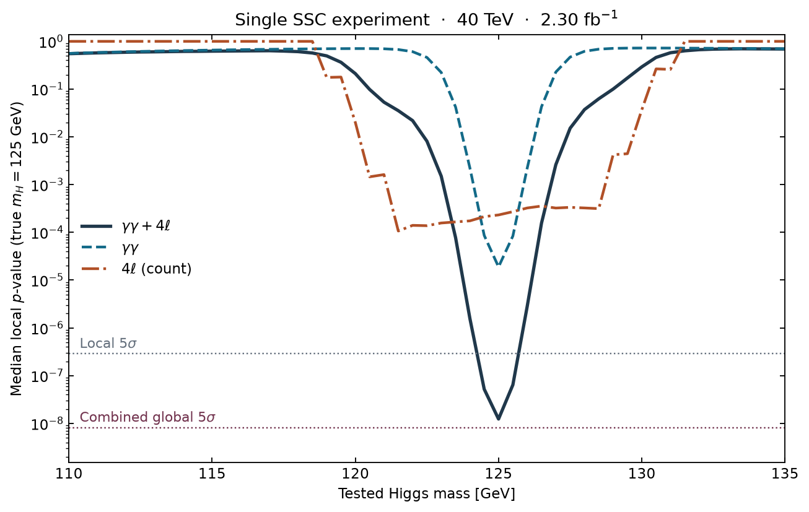

# When could one SSC experiment have discovered a Higgs of unknown mass?

The historical reference for this study is GEM's **80–800 GeV** Higgs programme. Its inclusive diphoton benchmarks spanned **80–160 GeV** and its four-lepton benchmarks spanned **140–800 GeV**. In our inclusive diphoton projection, searching the full 80–160 GeV interval gives a median global 5σ exposure of **5.27 fb⁻¹ (6.33 design months)** for a true 125 GeV Higgs. We chose the narrower intervals below to match our frozen four-lepton selection around 125 GeV. [Original GEM benchmark table, search ranges and our wider diphoton calculation](gem_range/README.md) · [Global combination with lepton-tagged photons](gem_range/lepton_tag/README.md)

A 40 TeV SSC experiment searching **110–135 GeV** in diphotons and four leptons reaches a **50% probability of global 5σ at about 2.30 fb⁻¹**, or **2.76 design months**. Testing a known mass of 125 GeV requires **1.83 fb⁻¹ (2.20 months)** for local 5σ. The scan costs about **26% more luminosity**, or **17 days** at 10 fb⁻¹ per year. The injected Standard Model Higgs has a mass of 125 GeV in every row.

| Mass hypotheses | Combined 50% [fb⁻¹] | Months | Combined 90% [fb⁻¹] | Months | Diphoton 50% [fb⁻¹] | Months |
| --- | ---: | ---: | ---: | ---: | ---: | ---: |
| Fixed 125 GeV | 1.83 | 2.20 | 3.26 | 3.91 | 3.61 | 4.33 |
| Scan 115–130 GeV | 2.22 | 2.66 | 3.83 | 4.59 | 4.65 | 5.58 |
| Scan 110–135 GeV | 2.30 | 2.76 | 3.95 | 4.74 | 4.84 | 5.81 |

Each scan is a separate choice of search interval made before examining the candidates. The combined test evaluates the same trial mass in both channels at 0.5 GeV steps. The diphoton-only result approximates a continuous scan using 0.05 GeV steps. Global 5σ means a background-only experiment has a one-sided probability of $2.87\times10^{-7}$ of passing the discovery threshold **anywhere in the chosen search** at that exposure. Around the combined median, the broader scan requires a local excess of 5.65σ. A local 5σ excess corresponds to 4.28σ globally in this search. The diphoton-only threshold is 5.71σ. [Combined calculation](combined-scan.json) · [Narrow scan](combined-narrow.json) · [Diphoton calculation](diphoton-scan.json)

At 2.30 fb⁻¹ the combined median local probability has its minimum around 125 GeV. The four-lepton curve uses an exact integer count in each overlapping window. The marked global threshold applies to the combination. The minimum of the median curves can lie above the threshold because each fluctuated experiment can reach its largest excess at a slightly different mass. For comparison, the diphoton-only figure shows the expected local score at its own median global discovery exposure of 4.84 fb⁻¹. [Combined figure (PDF)](combined-local-p.pdf) · [Diphoton-only figure (PDF)](diphoton-local-p.pdf) · [CMS discovery paper](https://arxiv.org/abs/1207.7235) · [Gross and Vitells on the look-elsewhere effect](https://arxiv.org/abs/1005.1891)

## How the projection works

- **Diphotons.** Fit two Gaussians with a common mean to the reconstructed 125 GeV signal histogram. Translate their mean across trial masses and integrate over the original 1 GeV mass bins. Construct a Gaussian score for each signal template, profiling the three continuum coefficients in the Gaussian approximation. The masses share the same bin fluctuations and the source covariance from the five simulated backgrounds. Match the signal response at 125 GeV to the published calibrated likelihood. The diphoton-only scan estimates the high-threshold probability from the expected number of upward crossings of the local score and checks it with 40,000 background-only importance samples. Its discovery power comes from 100,000 signal-injected simulations.
- **Four leptons.** Use the frozen classifier at 0.488 throughout its original 105–140 GeV preselection. For each trial mass, count events in a ±5 GeV window from the original independent test and the additional quark-continuum sample. This supports window centres from 110 to 135 GeV. The new half-GeV bins reproduce the ten historical 1 GeV bins at 125 GeV separately for all 27 signal and continuum samples. Overlapping windows share the same simulated counting fluctuations. To obtain physical Poisson means, set the few negative signed-MC cells to zero and rescale positive cells within each of 105–120, 120–130 and 130–140 GeV to its measured integral. The total magnitude of negative cells is 0.00198 fb in the signal and 0.00045 fb in the continuum. [Binned inputs and source hashes](fourlepton.json)
- **Combination.** Rank each trial mass by the Gaussian diphoton score plus the four-lepton count, with the likelihood-ratio weights used by the fixed-mass test. The count weight uses the background measured in that window. The reference signal used to weight a trial uses the 125 GeV yields. Calibrate each mass to its own local background-only probability. To find the distribution of the smallest local probability, simulate background-only experiments conditional on an exceedance at one randomly chosen mass. Reweight by the number of masses that crossed in the same experiment. This accounts for the chance that one fluctuation passes several neighboring tests. An independent simulation checks the global tail. Inject the actual 125 GeV signal and solve for the exposure at which the scan reaches 50% or 90% power. At the broader-scan median the effective trials factor is about 35 for the 51 tested masses. The numerical error from simulated experiments is about 0.01 fb⁻¹ or smaller under this model.

This projection uses the **central four-lepton background**. It uses the 125 GeV signal to model the off-mass photon resolutions and the relative channel weights. A forecast for a different true mass would also require its production rates, branching fractions and selection efficiencies. A publication-level assessment should validate the translated signal shape and the signal-like continuum bias at several other masses. Months assume design delivery from the start. Each probability refers to a test at a specified exposure.

## Heavy flavour and a conservative cross-check

The three heavy-flavour controls gave zero selected four-lepton candidates. They constrain an integrated rate and supply no measured distribution for the moving windows. For the 51-mass grid, testing each mass at a local one-sided threshold of 5.711σ limits the global false-positive probability to 5σ by the union bound, provided each local test is valid. Power calculated at the true on-grid mass alone gives **sufficient** exposures. For the combined central model they are 2.42 fb⁻¹ at 50% power and 4.09 fb⁻¹ at 90%, compared with 2.30 and 3.95 fb⁻¹ from the correlated scan. Using the upper heavy-flavour rate in the 125 GeV test gives sufficient exposures of **3.44 fb⁻¹ (4.13 months)** and **5.67 fb⁻¹ (6.80 months)** under that rate scenario. For four leptons alone the same construction gives **5.39 fb⁻¹ (6.47 months)** at 50% power with central background. [All grid bounds](grid_bounds.json)

## Reproduce

Run from the repository root with the [discovery dependencies](../requirements.txt). The compact four-lepton input and original diphoton mass spectra are included. The numerical outputs record the random seeds.

~~~bash
python3 discovery/mass_scan/diphoton.py
python3 discovery/mass_scan/combined.py
python3 discovery/mass_scan/combined.py --range 115 130 --output discovery/mass_scan/combined-narrow.json
python3 discovery/mass_scan/grid_bounds.py
~~~

To rebuild the four-lepton inputs on Timur, run the following from the checkout.

~~~bash
python3 discovery/mass_scan/fourlepton.py /home/shared/HiggsSSC/fourlepton/ssc40-20261112/reference --output /tmp/ssc-fourlepton-scan.json
cmp /tmp/ssc-fourlepton-scan.json discovery/mass_scan/fourlepton.json
~~~
