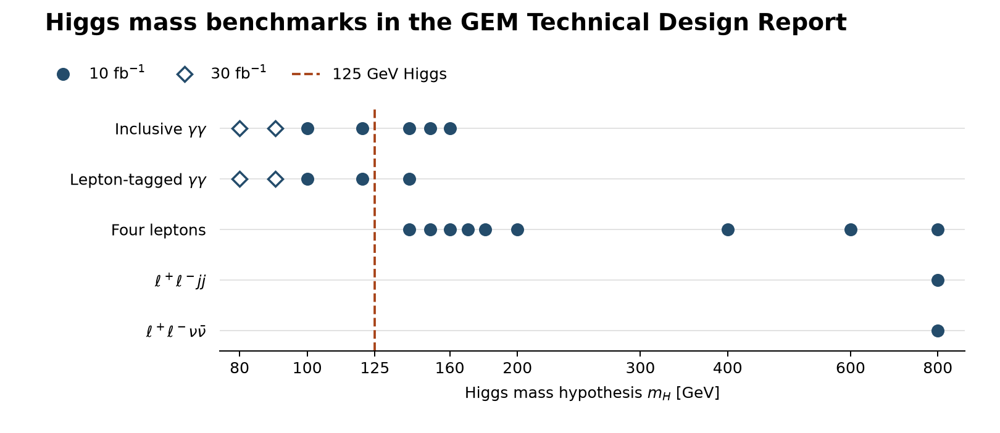
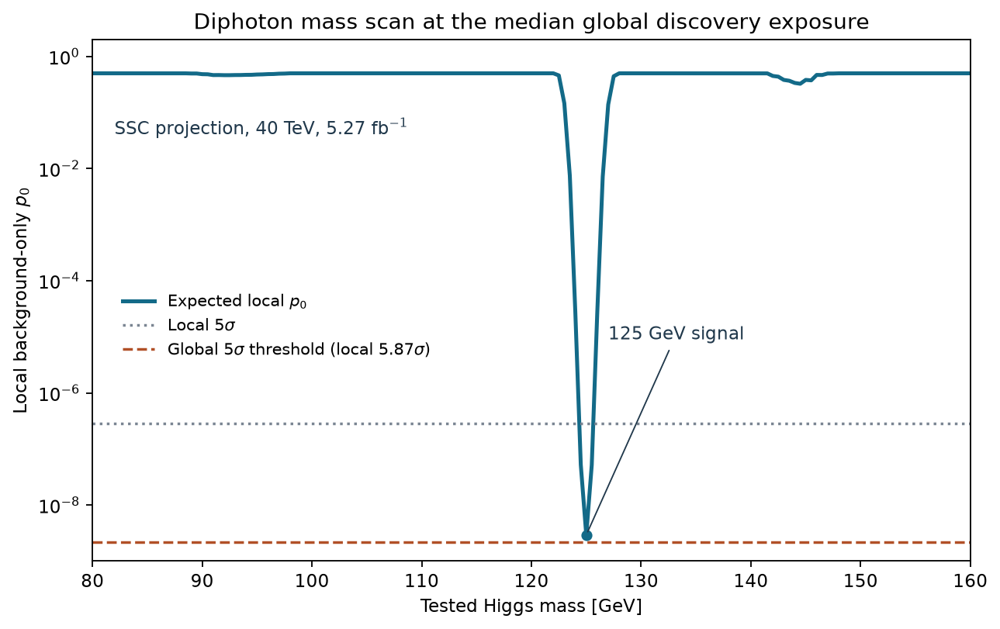
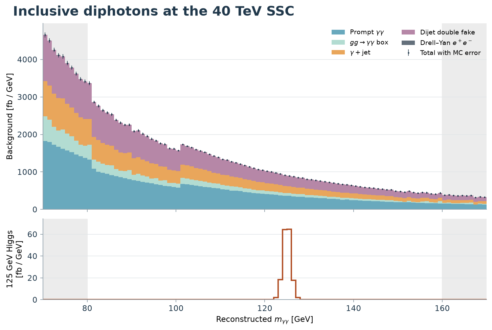

# The Higgs search ranges in the GEM Technical Design Report

The April 1993 GEM Technical Design Report tabulated the expected significance for a Standard Model Higgs at **13 masses from 80 to 800 GeV** in a single SSC experiment. The channel changed with the mass. The original table uses **30 fb⁻¹ at 80 and 90 GeV** and **10 fb⁻¹ at every other mass**. The June 1993 Higgs study used the same hypotheses and updated some of the high-mass results. The table and figure here use the April report. [GEM Technical Design Report, Table 2-3, p. 2-12](https://lss.fnal.gov/archive/other/ssc/ssc-gem-tn-93-262.pdf#page=52) · [June 1993 update, Table 1](https://lss.fnal.gov/archive/other/ssc/ssc-gem-tn-93-373.pdf#page=12)

| GEM search channel | Published Higgs masses [GeV] |
| --- | --- |
| Inclusive γγ | 80, 90, 100, 120, 140, 150, 160 |
| Lepton-tagged γγ from associated production | 80, 90, 100, 120, 140 |
| ZZ⁽*⁾ → 4ℓ | 140, 150, 160, 170, 180, 200, 400, 600, 800 |
| ZZ → ℓℓνν and ZZ → ℓℓjj | 800 |



**At 125 GeV** the original programme had two photon channels. Its nearest benchmark, 120 GeV, gave 7.8σ for inclusive γγ, 2.7σ for lepton-tagged γγ and 8.5σ for GEM's combination at 10 fb⁻¹. The four-lepton entries start at 140 GeV. Our modern γγ + 4ℓ sensitivity at 125 GeV answers a different question about the same machine. The inclusive photon and four-lepton benchmark ranges overlap from 140 to 160 GeV. [Benchmark data](benchmarks.csv) · [Vector figure](coverage.pdf)

GEM discussed the chance of an upward fluctuation when many mass bins are examined and required a peak significance of at least 5σ for discovery. It published sensitivities for specified Higgs masses. The report gives neither a uniform hypothesis spacing nor a calibrated global 5σ threshold for the full 80–800 GeV programme. The seven inclusive photon benchmarks show the masses at which GEM quoted sensitivity. A separate detector study also gives photon mass resolutions at 110 and 130 GeV. [GEM's definition of statistical significance, §2.3.1.3](https://lss.fnal.gov/archive/other/ssc/ssc-gem-tn-93-262.pdf#page=55)

## A true 125 GeV Higgs in the historical search

For the first calculation we inject a 125 GeV Higgs with our existing higher-order normalization and search the inclusive γγ spectrum from **80 to 160 GeV**. This uses the mass coverage of GEM's inclusive channel. The spacing, likelihood, detector response and look-elsewhere calculation belong to our projection. The earlier **2.30 fb⁻¹ (2.76 design months)** combined median applies to the restricted **110–135 GeV** search with four leptons included at 125 GeV. [Restricted-window result](../README.md)

**Inclusive diphoton discovery reach.** For a true 125 GeV Higgs, a single experiment has a 50% chance of global 5σ by **5.27 fb⁻¹ (6.33 design months)** when searching the GEM diphoton range on our 0.5 GeV grid. The corresponding 90% exposure is **9.17 fb⁻¹ (11.01 months)**. At the median the local threshold is **5.87σ**. The time conversion assumes 10 fb⁻¹ per year from the start. [Numerical scan results](diphoton-scan.json) · [Local probability versus mass (PDF)](diphoton-local-p.pdf)

| Modern inclusive γγ search, true mass 125 GeV | Median luminosity [fb⁻¹] | Design months |
| --- | ---: | ---: |
| Fixed mass, local 5σ | 3.61 | 4.33 |
| 110–135 GeV, same procedure and 0.5 GeV spacing | 4.82 | 5.78 |
| 80–160 GeV, same procedure and 0.5 GeV spacing | 5.27 | 6.33 |

Widening only the search range costs about **9.5% in luminosity**, or **0.55 design months**. Halving the spacing to 0.25 GeV over 80–160 GeV gives **5.28 fb⁻¹ (6.34 months)**. The result is a median at a specified exposure. A particular experiment could cross earlier or later.



## Inputs and checks

We reconstructed 1 GeV bins from 70 to 170 GeV for the 125 GeV signal and all five diphoton backgrounds. The extra 10 GeV at either end supplies sidebands for the outermost mass hypotheses. The full campaign contains 420,340,000 generated source events. In the common 105–160 GeV interval, every per-process bin and every element of its MC covariance agrees with the published 125 GeV analysis to numerical precision. [Per-bin rates](projection/rates.csv) · [Covariances and replication](projection/README.md) · [Comparison with the original spectra](projection/audit.json)



At each mass we translate the shape of the simulated 125 GeV peak and scale its width by GEM's tabulated resolution relative to 125 GeV. The detector model tightens the photon track veto within 10 GeV of the Z mass. The signal templates include the resulting efficiency change across a bin. The five central background templates already contain the change in response for genuine photons, photon + jet and electron fakes. The visible steps around 81 and 101 GeV arise from that selection. [GEM resolutions, Table 6](https://lss.fnal.gov/archive/other/ssc/ssc-gem-tn-93-373.pdf#page=37) · [GEM photon and electron identification](https://lss.fnal.gov/archive/other/ssc/ssc-gem-tn-93-373.pdf#page=46) · [SSC detector implementation](../../../hgammagamma/SSC_DETECTOR_RESPONSE.md)

The local statistic uses each mass window from 20 GeV below to 35 GeV above the test mass, clipped to the available spectrum. A linear fit removes changes in the continuum normalization, slope, curvature and genuine-photon acceptance in the Z band. Fluctuations at different masses share the same bin counts and full source-level MC covariance. We set the mean response to a true 125 GeV Higgs using the published sideband likelihood at that mass. We use Gaussian fluctuations about the central background for both background-only and signal-injected experiments. An independent 80,000-experiment importance sample checks the probability of a background exceeding the threshold anywhere on the discrete grid. The 100,000 signal-injected experiments give the exposure for each discovery probability. [Scan code](scan.py) · [Original 125 GeV calibration](../../README.md)

The global 5σ estimate is conditional on that background and detector model. At the median exposure, the linear statistic gives 5.90σ at the true mass before matching it to the original likelihood, which gives 5.82σ. Using a constant resolution changes the local threshold for global discovery by 0.002σ. A first-order check from the skewness of the Poisson counts suggests a local threshold shift of up to 0.034σ. The background-only simulations check the statistical calibration of the model. Independent data or control samples would further test continuum bias across the wider mass interval.

For a conservative cross-check, requiring a one-sided local 5.9034σ at each of 161 masses bounds the global false-positive probability at 5σ whenever each local test has its stated size. The true-mass test alone then gives sufficient exposures of **5.47 fb⁻¹ (6.56 months)** at 50% and **9.49 fb⁻¹ (11.39 months)** at 90%. [Finite-grid bound](diphoton-grid-bound.json)

## What remains for the full 80–800 GeV programme

A GEM-style low-mass combination needs a separate lepton-tagged photon selection, its backgrounds and its overlap with the inclusive photon selection. Extending four leptons to 800 GeV requires wider signal templates, continuum generation and mass-dependent selections. Our current four-lepton continuum was generated over 90–180 GeV in hard mass and our classifier was evaluated for the 125 GeV signal. The two additional ZZ channels enter GEM's table at 800 GeV. A global probability for the complete programme would require a joint calibration across the contributing channels and masses. [Four-lepton and diphoton inputs](../../REPLICATION.md)

## Reproduce

From the repository root, with the [discovery dependencies](../../requirements.txt) installed, run

```bash
python3 discovery/mass_scan/gem_range/coverage.py
python3 discovery/mass_scan/gem_range/projection/pool.py
python3 discovery/mass_scan/gem_range/scan.py
python3 discovery/mass_scan/grid_bounds.py --gem-diphoton > discovery/mass_scan/gem_range/diphoton-grid-bound.json
```

The [coverage plot script](coverage.py) uses the [machine-readable transcription](benchmarks.csv). The finite-grid calculation reads the same packaged 125 GeV inputs as the previous mass-scan calculation.
