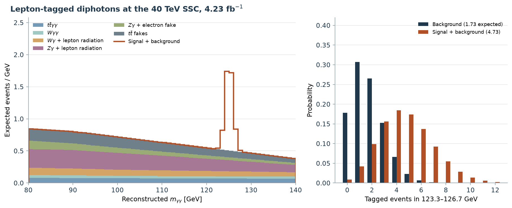

# Combining inclusive and lepton-tagged diphotons at the SSC

One 40 TeV experiment tests a common Higgs mass in two samples. It searches the inclusive diphoton mass range of **80–160 GeV**. From **80 through 140 GeV**, the search also uses a category with an isolated electron or muon accompanying the photon pair. Above 140 GeV only the untagged photon category contributes. The injected Standard Model Higgs has a mass of 125 GeV. GEM's original report quoted local significances at selected masses. We evaluate global discovery on a predeclared 0.5 GeV grid with 161 trial masses. [GEM Technical Design Report, Tables 2-9 and 2-10](https://lss.fnal.gov/archive/other/ssc/ssc-gem-tn-93-262.pdf#page=62) · [Inclusive diphoton projection](../README.md)

The [direct background simulation](background_mc/README.md) tests the historical 0.408 fb continuum with new electroweak and top samples. Its [first 148,000 collisions](background_mc/first-pass/README.md) also provide an independent combined-likelihood checkpoint.

## Discovery exposure with GEM's tagged background

With our 125 GeV ggF, WH and ttH signals and GEM's tagged background, one experiment reaches a **50% probability of global 5σ at 4.23 fb⁻¹ (5.08 design months)**. The 90% exposure is **7.08 fb⁻¹ (8.49 months)**. Sorting the same production samples into tagged and untagged categories saves **11.9% of the luminosity**, or **0.69 design months**, at the median.

| One-experiment search over the GEM mass ranges | 50% luminosity [fb⁻¹] | Design months | 90% luminosity [fb⁻¹] | Design months |
| --- | ---: | ---: | ---: | ---: |
| Original ggF signal, inclusive alone | 5.27 | 6.33 | 9.17 | 11.01 |
| ggF + WH + ttH, inclusive alone | 4.80 | 5.77 | 8.24 | 9.89 |
| ggF untagged, directly simulated WH + ttH in the tag only | 4.55 | 5.46 | 7.66 | 9.19 |
| **ggF + WH + ttH, separate untagged and tagged categories** | **4.23** | **5.08** | **7.08** | **8.49** |
| Previous ggF inclusive sample + tagged WH and ttH with GEM's efficiency and our rates | 4.37 | 5.25 | 7.31 | 8.77 |

The 5.27 to 4.23 fb⁻¹ comparison includes both the extra Higgs production and the information from the lepton tag. The 4.80 to 4.23 fb⁻¹ comparison isolates the benefit of categorizing the same sample. At 4.23 fb⁻¹ the tagged 125 GeV window contains **3.00 expected signal events and 1.73 background events**. The joint search requires a local excess of 5.87σ for global 5σ. At a predetermined 125 GeV mass, the same model reaches local 5σ at **2.97 fb⁻¹ (3.56 months)** at 50% power. The quoted times assume 10 fb⁻¹ per year from the start. [Median local probabilities (PDF)](combined-local-p.pdf) · [Numerical results for all scenarios](combined.json)

## Using GEM's tagged selection

GEM required an electron or muon and two photons with transverse momenta above 20 GeV and absolute pseudorapidities below 2.5. The extra transverse energy in cones of radius 0.30 around the lepton and 0.45 around each photon had to be below 5 GeV. The analysis also applied photon and lepton identification and required diphoton transverse momentum above 40 GeV. The count at each tested mass uses a window of ±2 mass resolutions. At 125 GeV this is **123.3–126.7 GeV**. [GEM event selection](https://lss.fnal.gov/archive/other/ssc/ssc-gem-tn-93-373.pdf#page=60) · [Mass windows and significance](https://lss.fnal.gov/archive/other/ssc/ssc-gem-tn-93-373.pdf#page=62)

**Directly simulated signal.** We showered 45,000 independent 40 TeV MC@NLO hard events for W⁺H, W⁻H and ttH with Herwig, forcing the Higgs to decay to two photons and allowing the associated particles to decay inclusively. The signal uses our production cross sections and BR(H → γγ) once. The tag finds **0.742 ± 0.033 fb** integrated over the peak before the mass window. W⁺H, W⁻H and ttH contribute 0.147, 0.117 and 0.479 fb. Direct electrons and muons from W decays supply 0.671 fb, and W → τ → e/μ decays supply 0.071 fb. The unsmoothed selected rate within 125 ± 1.7 GeV is **0.709 ± 0.032 fb**. The uncertainties here come from finite signal MC statistics. The per-event photon identification probabilities are shared wherever the two selections use the same photons. We assign the tag first and add the complementary WH and ttH distribution to the ggF untagged spectrum. This leaves 5.675 fb of untagged associated signal in 120–130 GeV. VBF and ZH are outside the production modes of this estimate. [Direct signal rates and mass templates](signal/direct.json) · [Signal sample, raw archive on Timur and reproduction commands](signal/README.md)

**Signal with GEM's efficiency.** Linear interpolation of GEM's WH + ttH results gives 0.700 fb of selected signal from 6.225 fb before the detector cuts at 125 GeV. We apply that 11.24% efficiency to our 40 TeV production cross sections for W⁺H, W⁻H and ttH, with BR(H → γγ) = 0.00227. This estimate counts direct W decays to electrons or muons. For ttH the branching factor is the probability of at least one such W decay. The updated prediction is **0.854 fb after selection**, of which **0.815 fb** lies in the GEM mass window. Photon and lepton efficiencies, branching fractions and window fractions each enter once. [Signal normalization by production mode](signal/rates.json) · [GEM cut flow](https://lss.fnal.gov/archive/other/ssc/ssc-gem-tn-93-373.pdf#page=61) · [W leptonic branching fraction](https://pdglive.lbl.gov/BranchingRatio.action?pdgid=S043.7)

**Tagged background.** GEM's selected total is **0.120 fb/GeV** at 125 GeV, giving **0.408 fb** in the counting window. For this category we use the full published total, which includes tt̄γγ, Wγγ, Wγ and Zγ with lepton radiation, Zγ with an electron mistaken for a photon, and tt̄ fakes. The untagged continuum uses the five background processes from our diphoton simulation. The tagged rates are GEM's leading-order and detector-background estimates. The rare prompt processes enter through its historical tagged total only. No modern tagged-background cross sections enter the nominal result. GEM itself explored doubling its tagged background. We repeat that variation with the doubled rate used in both the background-only and the signal-plus-background model. It is a stress test of a different assumed rate. [GEM Tables 19 and 20](https://lss.fnal.gov/archive/other/ssc/ssc-gem-tn-93-373.pdf#page=61) · [Tagged background inputs](gem_inputs.json)

Doubling the tagged background moves the direct median from 4.23 to **4.46 fb⁻¹ (5.35 months)** and the 90% exposure from 7.08 to **7.54 fb⁻¹ (9.05 months)**. Varying only the tagged signal normalization by its simulation error gives **4.19–4.27 fb⁻¹** at the median, with the mass shape held fixed. The conservative overlap check gives **4.25 fb⁻¹ (5.10 months)**. Each check changes one assumption or the event assignment described below.



The left panel shows all six published background components and their sum with the signal. We normalize the rounded component entries in each bin to GEM's separately tabulated total. The right panel shows how integer counts fluctuate at the same luminosity. [Binned rates](tagged-spectrum.csv) · [Vector figure](tagged-spectrum.pdf)

## Discovery test

The untagged term uses the Gaussian diphoton score and the 125 GeV sideband calibration from the [inclusive analysis](../README.md). The tagged term uses an exact Poisson count. The nominal power calculation uses the reconstructed 125 GeV mass template from the showers. Tests at other trial masses use relative signal rates from GEM's benchmarks for their likelihood weights. The separate GEM-efficiency calculation uses a Gaussian signal mass template. For each trial mass the likelihood ratio weights the two categories according to their expected signals and backgrounds. Local probabilities use the full Gaussian–Poisson null distribution. For the global threshold, simulated background-only experiments test all masses together. Overlapping tagged mass windows share their events, and the untagged scores share their bin fluctuations and MC covariance. A signal-injected experiment passes if any common trial mass reaches the calibrated threshold. Calendar time assumes design delivery of 10 fb⁻¹ per year from the start. The probabilities refer to the specified exposures.

Removing the tagged signal reproduces the published inclusive-only scan within sampling fluctuations. Each combined reach also passes an independent simulation of the global background tail and a check against the exactly summed fixed-125 GeV discovery probability. [Combined likelihood and checks](tagged_scan.py) · [Results](combined.json)

**Category overlap.** Each event is assigned to the lepton tag first. The direct WH and ttH samples give 0.709 fb of shared selected rate before the mass windows. We subtract it event by event from their inclusive contribution. For ggF we conservatively remove a fraction estimated from potential lepton tags without crediting it to the tagged signal. An event-level check on the 100,000-event ggF sample found that 0.19% of the selected signal in 120–130 GeV had both diphoton transverse momentum above 40 GeV and a shower electron or muon passing the tag kinematics before identification or isolation. Loosening the lepton cuts to 15 GeV and |η| < 3 gives 0.38%. Even assigning the *entire* historical tagged background away from our inclusive continuum would remove less than 0.015% in any 1 GeV bin over the shared 80–140 GeV search. This comparison bounds double counting for the adopted GEM background. An independent measurement of extra fake-lepton backgrounds would test the completeness of that historical prediction. [ggF source-event check](ggf_overlap.json) · [Inclusive background inputs](../projection/rates.csv)

**What the existing backgrounds can check.** We matched photon pairs to the shower lepton and jet records in two additional controls, one million prompt γγ and one million γ + jet source events. In the 123.3–126.7 GeV window, there were 130 and 73 selected photon pairs with transverse momentum above 40 GeV, respectively. One prompt event had a lepton with the required kinematics and none passed an isolation check based on the stored jets in either sample. The event weights are several fb apiece, compared with GEM's expected 0.408 fb in this window. Those samples cannot independently establish the tagged rate or the jet-to-lepton fake contribution. The 5σ projections therefore depend on GEM's background model. [Control samples, dijet estimate and limitations](background-control.md) · [Control counts and source hashes](inclusive-lepton-control.json)

## Reproduce

Run from the repository root with the [discovery dependencies](../../../requirements.txt). The calculation uses the packaged event spectra and historical rates.

```bash
tag=discovery/mass_scan/gem_range/lepton_tag
python3 "$tag/gem_rates.py"
python3 "$tag/signal/transfer.py"
python3 "$tag/signal/summarize.py" "$tag/signal/events.npz" > /tmp/ssc40-tagged-signal.json
python3 "$tag/tagged_scan.py"
python3 "$tag/tagged_spectrum.py"
```

The first command reproduces GEM's ten tagged significance entries at 10 and 30 fb⁻¹ to within 0.07σ from the rounded published inputs. The second prints the updated tagged rate. To repeat the ggF overlap check on Timur, run the following with the original HwSim ROOT file and the released student diphoton dataset.

```bash
run=~/Projects/HiggsSSC/hgammagamma/HOAnalysis/runs/ho_100k_02
python3 "$tag/ggf_overlap.py" "$run/Signal/events/signal_gg_h_aa/herwig/events/signal_gg_h_aa.root" \
  /home/shared/HiggsSSC/diphoton/ssc40-20261118
```
