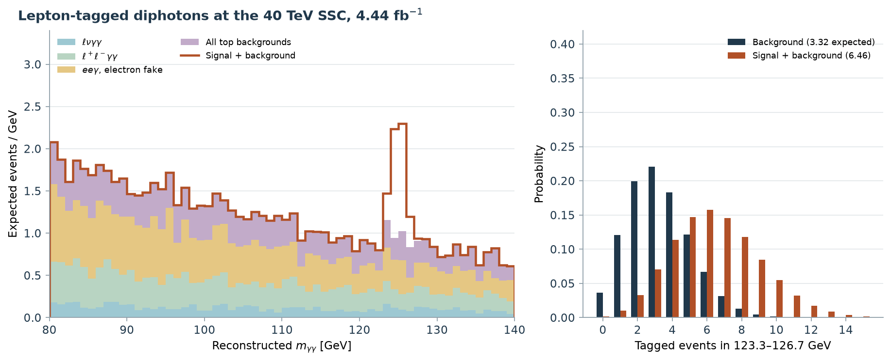

# Simulating the lepton-tagged diphoton continuum at 40 TeV

GEM quotes total selected background densities of 0.13 and 0.09 fb/GeV at 120 and 140 GeV. Linear interpolation and integration over 123.3–126.7 GeV give 0.408 fb. This is the reconstructed diphoton mass window for the fixed 125 GeV comparison. The discovery scan also needs the continuum throughout the tagged range of 80–140 GeV. [GEM Higgs study, sections 5.1–5.2 and Tables 19–20](https://lss.fnal.gov/archive/other/ssc/ssc-gem-tn-93-373.pdf#page=60)

## Result for a 125 GeV Higgs boson

The simulated background in the 123.3–126.7 GeV window is **0.746 ± 0.039 fb**, or **1.83 times** the interpolated GEM estimate. The error covers finite background samples and hard-process integration. The calculation uses 2,539,500 generated collisions across the nominal samples and the independent eeγ acceptance extension. Of these, 9,472 contribute to the tagged window. Fitting the adjacent masses with the window blinded gives 0.653–0.668 fb across the accepted smooth fit functions. [Monte Carlo inputs and component comparison](final/combined-mc.json) · [Blinded sideband fits](final/sidebands.json)

| Tagged contribution at 125 GeV | This simulation [fb] | GEM [fb] |
| --- | ---: | ---: |
| Charged current, two genuine photons | 0.082 ± 0.012 | 0.092 |
| Neutral current, two genuine photons | 0.160 ± 0.015 | 0.140 |
| Electron reconstructed as a photon in eeγ | 0.257 ± 0.026 | 0.037 |
| All top sources | 0.246 ± 0.021 | 0.145 |
| **Total** | **0.746 ± 0.039** | **0.408** |

For the eeγ row, substituting the historical Zγ hard process, EHLQ1 parton densities, gluon-fusion prescription and 3% tracker fake probability gives **0.1341 ± 0.0158 fb** with our shower and detector response. These substitutions explain **56 ± 3%** of the absolute difference from GEM. The fake probability itself changes the rate by just 1%. The 1992 GEM data also localize a discrepancy before the diphoton transverse-momentum cut. [Hard cross sections, lepton and photon cuts, and electron fake probabilities](zee_audit/README.md)

For one 40 TeV experiment, the joint search over the GEM ranges reaches a **50% probability of global 5σ at 4.44 fb⁻¹ (5.33 design months)**. The 90% exposure is **7.48 fb⁻¹ (8.98 months)**. At the median the tagged window contains 3.15 expected Higgs events and 3.32 background events. The median rises by 4.9% relative to the same search with GEM's tagged continuum. Categorizing the same signal with the lepton tag saves 7.5% of the median exposure relative to the inclusive-only search. The times assume 10 fb⁻¹ recorded each year.

| Background or analysis choice | Median [fb⁻¹] | Design months | 90% [fb⁻¹] | Design months |
| --- | ---: | ---: | ---: | ---: |
| Simulated tagged continuum | 4.44 | 5.33 | 7.48 | 8.98 |
| GEM tagged continuum | 4.23 | 5.08 | 7.08 | 8.49 |
| Inclusive diphotons alone, same Higgs production | 4.80 | 5.77 | 8.24 | 9.89 |

The direct count lies 1.84–2.27 combined standard deviations above the six blinded predictions. Rescaling the simulated tagged continuum to their two endpoint normalizations, and repeating the complete global calibration, gives **4.40–4.41 fb⁻¹ (5.28–5.29 months)** for a median discovery and **7.40–7.41 fb⁻¹ (8.88–8.90 months)** for 90% probability. This check varies the normalization and uses the simulated mass shape throughout the scan. [Blinded-normalization discovery fits](final/sideband-reach.json)

The 125 GeV mass fixed in advance gives a median local 5σ at 3.10 fb⁻¹. The global calculation uses 40,000 simulated experiments per full evaluation. The simulation error on its median crossing from the power calculation is 0.003 fb⁻¹. Varying the tagged continuum normalization by one background MC error gives 4.43–4.46 fb⁻¹. The corresponding median with the restricted eeγ generation cuts is 4.41 fb⁻¹. Applying GEM's 20% enhancement to the neutral-current samples gives 4.47 fb⁻¹. Normalizing only the simulated eeγ fake component to GEM's value gives 4.33 fb⁻¹. The full uncertainty in detector misidentification and missing higher orders requires independent inputs.



[Signal and background mass spectrum (PDF)](final/tagged-spectrum.pdf) · [Expected cross sections in 1 GeV bins](final/tagged-spectrum.csv) · [Tagged continuum compared with GEM (PDF)](final/tagged-background.pdf) · [Median local p-value across the joint search (PDF)](final/combined-local-p.pdf)

## Definition of the calculation

The proton beam energy is 20 TeV per beam. The background calculation uses leading-order MadGraph5_aMC@NLO matrix elements and the NNPDF4.0 NLO QED set (LHAPDF 335900). Herwig 7.3 supplies the parton shower, decays and hadronization. The production cross section in each LHE file supplies the absolute normalization. Each hard collision contributes detector outcomes whose probabilities include object identification and the 98.8% event trigger. The central value uses the project's isolated-photon response and a tracker misidentification probability of 1/33 for electrons. GEM quotes 3% at 96% photon acceptance. The jet-to-photon response includes isolation and photon identification. These detector efficiencies enter the estimate of the fake background. The generated collision samples provide an independent check of the corresponding selected cross sections conditional on those efficiencies. [GEM electron identification and jet response](https://lss.fnal.gov/archive/other/ssc/ssc-gem-tn-93-373.pdf#page=43)

| Generated process | Contribution to GEM Table 19 |
| --- | --- |
| Charged-current ℓνγγ | Wγγ together with Wγ and lepton radiation, including interference at tree level |
| Neutral-current ℓ⁺ℓ⁻γγ | Radiative neutral-current contribution with Z/γ* interference |
| e⁺e⁻γ | One electron reconstructed as a photon, a genuine photon and a distinct tagged electron |
| tt̄, tt̄γ and tt̄γγ | Production photons, photons radiated in top or W decays, and electrons or jets reconstructed as photons |

The genuine electroweak samples include all three charged-lepton flavours. The detector selects a final electron or muon. The mass-window count requires two photons and a tagged lepton with transverse momentum above 20 GeV and absolute pseudorapidity below 2.5. The reconstructed pair must have transverse momentum above 40 GeV. The photon and lepton isolation cones have radii 0.45 and 0.30 with a 5 GeV calorimeter-energy threshold. The reconstruction uses the stable particles available in HwSim and the project’s detector smearing and fiducial cracks. Ordinary QCD jet-to-lepton fakes and a dedicated bb̄γγ sample are outside this calculation. GEM judged the latter negligible after isolation. The existing study quantified the available controls on the former. [Selection and background estimates](https://lss.fnal.gov/archive/other/ssc/ssc-gem-tn-93-373.pdf#page=60) · [Inclusive fake-lepton controls](../background-control.md)

GEM enhanced its quark-initiated Zγ estimate by 20% to approximate gluon fusion. The nominal modern inputs use their generated cross sections. A separate refit applies GEM's 20% enhancement to the two Z samples. All background cross sections here are at leading order in the hard process. The signal normalization and the inclusive diphoton continuum come from the [existing discovery calculation](../README.md).

## Statistical interpretation

The statistical target for the direct count is a combined MC standard error of 0.0408 fb at 125 GeV. The covariance sums contributions from independent hard collisions, including correlations between different possible photon pairs in the same collision. Showers of one hard integration share its integration error. A failed shower counts in the generated denominator with zero selection weight. Real collision counts in the discovery simulation fluctuate according to the Poisson distribution in the tagged category.

The combined likelihood uses the same 125 GeV signal and untagged score as the [published GEM-background calculation](../tagged_scan.py). The tagged Poisson means are computed from the simulated continuum. The fit integrates bin contents across all overlapping trial windows, with 123.3 and 126.7 GeV explicit bin boundaries. It calibrates the global background tail and computes the fraction of signal-injected experiments crossing that threshold. Time assumes a single experiment recording 10 fb⁻¹ per year from the start of design operation.

The individual GEM entries imply 0.0918 fb for the charged-current rows together, 0.1403 fb for neutral-current radiation, 0.0374 fb for the electron fake and 0.1445 fb for the two top rows together. Their sum is 0.4140 fb. The 0.408 fb reference uses the separately rounded total row. The associated study groups the top contributions before comparing them because the allocation between production, decay radiation and misidentification depends on the generator. [GEM Table 19](https://lss.fnal.gov/archive/other/ssc/ssc-gem-tn-93-373.pdf#page=61)

For eeγ we also generated events outside the initial matrix-element cuts to measure migrations into the reconstructed selection. Six of 288,000 independent confirmation events contributed to the Higgs window. They add 0.04476 ± 0.01918 fb to the 0.21269 ± 0.01778 fb measured inside the initial cuts. The two regions have disjoint phase space. Adding their mass spectra and covariances gives 0.25745 ± 0.02616 fb for the electron-fake contribution. A separate 96,000-collision pilot informed the choice of confirmation exposure. The reported correction uses only the three prespecified confirmation seeds. [Independent confirmation](zee-confirmation.json) · [Binned contribution and covariance](zee-confirmation-spectrum.json.gz)

The production cards and detailed reproduction instructions cover the [electroweak samples](ew_README.md), [top samples and radiative decays](top_backgrounds.md), and [detector response and normalization](response.md).

## Repeating the fit

The student checkout includes both input spectra. From the repository root with the [discovery dependencies](../../../../requirements.txt) installed, reproduce the discovery calculation and blinded check with

```bash
code=discovery/mass_scan/gem_range/lepton_tag/background_mc
python3 "$code/refit.py" "$code/final/background.json.gz" --zee-complement "$code/zee-confirmation-spectrum.json.gz" --output /tmp/ssc40-tagged-fit
python3 "$code/response_sidebands.py" "$code/final/background.json.gz" /tmp/ssc40-tagged-fit/sidebands.json --zee-complement "$code/zee-confirmation-spectrum.json.gz"
python3 "$code/sideband_reach.py" "$code/final/background.json.gz" "$code/zee-confirmation-spectrum.json.gz" /tmp/ssc40-tagged-fit/sidebands.json /tmp/ssc40-tagged-fit/sideband-reach.json
```

To rebuild the core spectrum from the underlying detector packets, set `campaign` to the detector-packet directory and `out` to the output directory. The following commands produce the direct spectrum, sideband cross-check, global discovery probabilities and figures.

```bash
code=discovery/mass_scan/gem_range/lepton_tag/background_mc
mkdir -p "$out"
python3 "$code/response_summary.py" "$campaign" "$out/background.json" --top-dileptonic
python3 "$code/response_sidebands.py" "$out/background.json" "$out/sidebands.json" --zee-complement "$code/zee-confirmation-spectrum.json.gz"
python3 "$code/refit.py" "$out/background.json" --output "$out" --zee-complement "$code/zee-confirmation-spectrum.json.gz"
```

The spectrum contains bin-integrated rates, their covariance and the cross section, seed and input identity for each independent integration. The fit reports a median and a 90% discovery probability. The MC variations change the tagged continuum by one window normalization error in both the background-only and signal-injected experiments. Shape and misidentification model changes are reported separately. The fit also records a predetermined 125 GeV result and validates the global-tail calculation against independent null experiments.

## Raw event release on Timur

The shared student directory is `/home/shared/HiggsSSC/student-results/ssc40-tag-background-20261125`. It contains the hard-event inputs, detector packets, run cards, software fingerprints, fit inputs and figures. A clean extraction of the core and eeγ archives reproduced all 72 bin rates, their covariance matrices and the complete list of contributing packets. The two archives cover 2,324 core packets and 192 independent eeγ acceptance packets. The SHA-256 of the public checksum file `SHA256SUMS` is `5c5c60874ac0dcbbf9b3f70871c5b0eb9197c2e419add95b2ace1847a7379f27`. [Release manifest](final/timur-release.json) · [Raw replay audit](final/raw-replay.json)

To verify the release on Timur, set `scratch` to a writable directory with sufficient space to unpack one archive at a time. Run `verify_release.py` with Python and the discovery dependencies installed.

```bash
release=/home/shared/HiggsSSC/student-results/ssc40-tag-background-20261125
(cd "$release" && sha256sum -c SHA256SUMS --quiet)
python3 discovery/mass_scan/gem_range/lepton_tag/background_mc/verify_release.py "$release" --scratch "$scratch"
```
