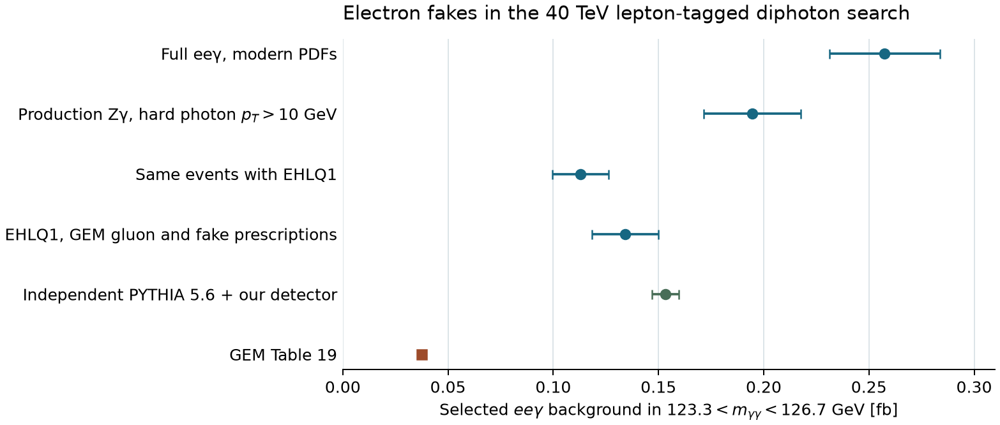

# Why the tagged eeγ background exceeds the GEM estimate

At 40 TeV, our simulated eeγ background is **0.2575 ± 0.0262 fb** in the 123.3–126.7 GeV diphoton window. A linear interpolation of GEM's 1993 electron-fake row gives **0.0374 fb**. In this process, one electron acts as a photon, the genuine photon supplies the second photon, and the other electron supplies the lepton tag. The excess is present throughout the tagged search range. Integrating over 80–140 GeV gives **6.13 ± 0.12 fb** for our simulation and **1.00 fb** for GEM. The respective fractions in the Higgs window are **4.20 ± 0.41%** and **3.74%**. All errors below describe numerical integration and finite simulated samples. GEM supplies rounded densities without a component uncertainty. [GEM Table 19](https://lss.fnal.gov/archive/other/ssc/ssc-gem-tn-93-373.pdf#page=61) · [Mass interpolation and finite-sample errors](legacy.json)

## Hard production and the electron fake

We changed one assumption at a time for the simulated collisions contributing to the Higgs window. All 149 contributing collisions from the 640,000 generated events were matched to their hard partons and original detector weights. Changes in adjacent rows share events. Their errors use the covariance of those events. The table uses the full resonant mass tail. [Hard matrix elements and production integrations](hard_process.md) · [Correlated window rates](comparison.json)

| Successive assumptions | Selected eeγ [fb] | Change from preceding row [fb] |
| --- | ---: | ---: |
| Full tree-level eeγ, modern NNPDF4.0 | 0.2575 ± 0.0262 | |
| Use production Zγ with Z → ee and hard photon transverse momentum above 10 GeV | 0.1945 ± 0.0231 | −0.0630 ± 0.0115 |
| Also replace NNPDF4.0 with GEM's EHLQ1 | 0.1129 ± 0.0133 | −0.0816 ± 0.0098 |
| Also apply GEM's 20% increase for gluon-initiated Zγ | 0.1354 ± 0.0160 | +0.0226 ± 0.0027 |
| Also set the electron tracker fake probability to exactly 3% | 0.1341 ± 0.0158 | −0.00135 ± 0.00016 |
| GEM's published electron-fake row at 125 GeV | 0.0374 | |

Together these changes account for **56.1 ± 3.4%** of the absolute 0.2201 fb difference, conditional on our shower and detector response. The remaining difference is **0.0967 ± 0.0158 fb**, a rate ratio of **3.58 ± 0.42**. The share attributed to each individual change depends on the order. For example, changing the PDFs first, with the full eeγ matrix element, lowers our rate by **0.1057 ± 0.0110 fb**, or 48% of the original gap. Across the generator acceptance the PDF change lowers the cross section by 50.6%, while increasing the fraction that passes our detector selection by 19.3%. [PDF reweighting and covariance](pdf.json)

The hard-production scale can be checked independently. The 1992 study quotes 14.4 pb for Zγ → ℓℓγ above a 10 GeV partonic transverse-momentum cut, with ℓ denoting electron or muon. A native PYTHIA 5.6 run with EHLQ1 gives **5.986 ± 0.003 pb** for the quark channel with Z → ee and **11.967 ± 0.019 pb** with both flavours enabled. Applying GEM's 1.20 gluon prescription to the two-flavour value gives **14.361 ± 0.023 pb**. This supports an electron-only historical rate of about **7.2 pb** including that prescription. A modern leading-order integration with NNPDF4.0 gives **12.426 ± 0.017 pb** for production Zγ → eeγ within 15 Z widths. It is about **2.08 times** the native quark-only rate or **1.73 times** the historical electron-only estimate including gluons. These inclusive ratios and the selected-event changes in the table describe overlapping effects. The Higgs signal normalization plays no part in this background calculation. [GEM 1992 production study](https://lss.fnal.gov/archive/other/ssc/ssc-gem-tn-92-126.pdf#page=31) · [Modern production calculation](hard_z_decay.json) · [Native PYTHIA run](vintage.json)

GEM's printed Table 19 discussion says **3%** electron misidentification at **96%** genuine-photon acceptance. Our detector uses **1/33 = 3.0303%** for the tracking step and a separate **90%** calorimetric photon efficiency. Using 3.00% at the same step changes the full prediction to **0.2549 fb**, a decrease of 1.0%. Explaining the entire original discrepancy through this parameter alone would require **0.44%** at the tracker, or **0.40%** including the 90% efficiency. The opposite-charge fake assignments are mutually exclusive detector outcomes, and the tag must come from the other electron. [GEM working point, printed p. 52](https://lss.fnal.gov/archive/other/ssc/ssc-gem-tn-93-373.pdf#page=61) · [Object and event probabilities](../response.md)



The error bars give the Monte Carlo standard errors. The independent PYTHIA 5.6 point includes GEM's 20% gluon increase and 3% tracker probability. The GEM point uses its published densities. [Vector figure](ee-background-comparison.pdf)

## Lepton and photon selection

The 1993 analysis applies 20 GeV transverse-momentum thresholds and absolute pseudorapidity below 2.5 to both photons and the lepton. It uses isolation cones of 0.45 for photons and 0.30 for the lepton, followed by shower-shape and track identification and a 40 GeV transverse-momentum cut on the photon pair. Our analysis implements those thresholds. GEM models energy in calorimeter cells, with detector and pileup noise and shower-shape response. We use smeared stable-particle energies, detector cracks, particle isolation and factorized identification probabilities. Table 19 gives intermediate efficiencies for the Higgs signal and only final rates for eeγ. [GEM tagged selection](https://lss.fnal.gov/archive/other/ssc/ssc-gem-tn-93-373.pdf#page=60) · [GEM isolation definition](https://lss.fnal.gov/archive/other/ssc/ssc-gem-tn-93-373.pdf#page=17) · [Modern detector replay and selection variants](detector-replay.md)

In the modern Higgs window, 57.3% of truth-matched candidate assignments pass the genuine-photon kinematics. Of those, 74.3% pass the fake electron's photon kinematics, and 71.9% of the remainder have the second electron in the lepton-tag acceptance. Detector cracks then accept 71.6%. Requiring isolation of all three objects accepts 52.4% of those. The 40 GeV pair cut accepts **62.0 ± 3.3%** after identification. The cutflow reproduced every original selected pair in all 498 shower blocks. [Cutflow, conditional efficiencies and charge assignments](detector-replay.md)

The 1992 precursor gives an additional comparison in **75–165 GeV** for its ideal calorimeter. At 10 fb⁻¹ it predicts **51** electron fakes before and **32** after the 40 GeV pair cut, an efficiency of **62.7%**. Our nominal full eeγ simulation gives **15.38 → 8.12 fb**, or **52.8 ± 0.6%** efficiency. Our excess relative to that earlier result is already **3.02-fold before** the pair cut and falls to **2.54-fold after** it. With native PYTHIA 5.6, full angular coverage inside the fiducial pseudorapidity range, the earlier isolation threshold of 5 GeV + 0.10 times the candidate transverse momentum, and our identification model with GEM's tracker and gluon factors, the corresponding rates are **15.82 → 8.42 fb**, or **53.2%** efficiency. This last comparison uses our energy smearing and identification in place of the historical calorimeter response. [1992 assumptions](https://lss.fnal.gov/archive/other/ssc/ssc-gem-tn-92-126.pdf#page=33) · [1992 Table 15](https://lss.fnal.gov/archive/other/ssc/ssc-gem-tn-92-126.pdf#page=34) · [Native cut rates](vintage.json)

With our nominal geometry and isolation and the historical hard generator and tracking/gluon conventions, the direct PYTHIA 5.6 shower simulation gives **0.1533 ± 0.0063 fb** in the 125 GeV window. It reproduces the historical total hard rate, yet predicts about four times the 1993 selected rate. Quantifying how much comes from each of GEM's lepton acceptance, photon isolation, shower shape or event-normalization choices would require its intermediate electron-fake yields or original event record. [Native selection code](vintage_response.cc) · [Independent generator results](vintage.json)

## Reproducing the comparison

From the repository root, the following commands rederive the interpolation, the comparison table and both plot formats using the student checkout, Python, NumPy and Matplotlib.

```bash
audit=discovery/mass_scan/gem_range/lepton_tag/background_mc/zee_audit
work=$(mktemp -d)
python3 "$audit/legacy.py" --output "$work/legacy.json"
cmp "$audit/legacy.json" "$work/legacy.json"
python3 "$audit/compare.py" --output "$work"
cmp "$audit/comparison.json" "$work/comparison.json"
```

To regenerate the independent historical control, use a C++ compiler, gfortran and ROOT with `root-config` on the path. The build downloads and checks the archived PYTHIA 5.6 and JETSET 7.3 source hashes. The default run uses 12 independent electron seeds of 80,000 events and 12 two-flavour seeds of 10,000 events. The two-flavour runs check the total production rate. The electron runs also measure the detector response. [PYTHIA archive](https://pythia.org/pythia6/) · [Input hashes and seeds](vintage_runs.py)

```bash
bash "$audit/build_vintage.sh" "$work/generator"
python3 "$audit/vintage_runs.py" "$work/generator/vintage" "$work/vintage.json" --workers 8
```

For a complete hard-event and detector replay, use the released hard integrations and shower receipts on Timur. The detector instructions define the extracted core and complementary directories and replayed shower trees. With those inputs and the two historical Fortran files in the generator build directory, the following commands recompute the PDF changes. The Python environment must include LHAPDF with `NNPDF40_nlo_as_01180_qed` installed. The optional event weights are consumed by the hard matrix analysis. [Archived inputs](../final/timur-release.json) · [Detector commands](detector-replay.md) · [Matrix-element commands](hard_process.md)

```bash
build="$work/generator"
gfortran -shared -fPIC -O2 -std=legacy -fallow-argument-mismatch -fno-automatic \
  "$audit/pdf_ehlq1.f90" "$build/pythia56.f" "$build/jetset73.f" -o "$build/libehlq1.so"
release=/home/shared/HiggsSSC/student-results/ssc40-tag-background-20261125
python3 "$audit/pdf_reweight.py" "$work/core" "$work/wide" \
  "$release/background.json.gz" "$release/zee-confirmation-spectrum.json.gz" \
  "$work/showers" "$build/libehlq1.so" "$work/pdf.json" --weights "$work/pdf-events.json"
```
