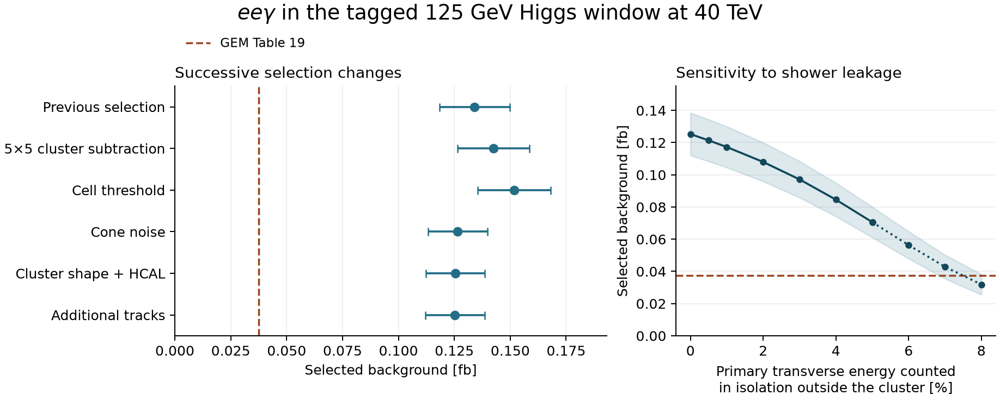

# Testing GEM isolation and shower shape in tagged eeγ events

Using the historical hard-process weights, an event-by-event approximation to GEM's calorimeter isolation and cluster identification changes the electron-fake background from **0.1341 ± 0.0158 fb** to **0.1253 ± 0.0133 fb** in the reconstructed 123.3–126.7 GeV diphoton window. GEM's electron-fake row gives **0.0374 fb** at 125 GeV. The difference between the two simulations is **−0.0088 ± 0.0049 fb** with their common-event covariance. These changes account for **9.1 ± 4.2%** of the previous 0.0967 fb excess, leaving a ratio of **3.35 ± 0.35**. This comparison holds the reconstructed four-momenta fixed and models the energy contributed by nearby particles and noise. The additional isolation energy from each candidate's own shower is varied separately below. The errors in the tables cover Monte Carlo statistics and numerical integration. [GEM Table 19](https://lss.fnal.gov/archive/other/ssc/ssc-gem-tn-93-373.pdf#page=61) · [Previous hard-process comparison](../README.md) · [Rates and paired covariance](selection.json)

## What changes the selected rate

| Successive detector changes on the same events | Selected eeγ [fb] |
| --- | ---: |
| Previous scalar isolation, GEM hard inputs and 3% electron tracking fake rate | 0.13407 ± 0.01580 |
| Sum tower transverse energies in each cone and subtract the electromagnetic 5 × 5 cluster | 0.14255 ± 0.01606 |
| Sum cells above 0.5 GeV in transverse energy | 0.15165 ± 0.01633 |
| Add thermal and pileup noise using GEM's measured cone distribution | 0.12647 ± 0.01327 |
| Also apply the cluster energy-concentration and hadronic-energy tests | 0.12543 ± 0.01325 |
| Also require the appropriate extra-track veto | **0.12531 ± 0.01325** |
| GEM 1993 | **0.03740** |

Subtracting energy in the cluster and suppressing low-energy cells promotes some previously rejected candidates. Adding the noise reduces the cell-threshold result by **0.02518 ± 0.00353 fb**. Across the three isolation changes together, the rate falls by **0.00759 ± 0.00479 fb**. Substituting the isolation of each object in every possible order and averaging the changes gives **−0.00499 ± 0.00264 fb** for the genuine photon, **−0.00393 ± 0.00268 fb** for the electron supplying the fake photon, and **+0.00132 ± 0.00220 fb** for the tagged electron. The three contributions share the same collisions. [Object-by-object contributions and covariance](paired_roles.json)

The transverse sizes of the electromagnetic and hadronic towers follow the barrel and approximate stepped endcap segmentation in the historical fast simulation. The noise probability uses the non-Gaussian distribution for an otherwise empty radius-0.45 cone and the three published loss probabilities. With a 5 GeV allowance, its single-cone loss is **5.4%**. For the radius-0.30 electron-tag cone we scale the centered fluctuation by the radius ratio, giving a **2.66%** noise-only loss. Using the same width as the photon cone or scaling the width with the stronger pileup-only area law gives final selected rates of **0.1214** and **0.1278 fb**. The main result assumes independent noises conditional on the three cone activities. Allowing arbitrary dependence at fixed single-cone probabilities gives mathematical lower and upper rate limits of **0.1215–0.1390 fb** for this model. The tower calculation sums pointlike particle deposits before folding in the measured thresholded-cone noise. Fluctuations that move individual cells across threshold when noise and shower deposits overlap require the historical cell readout or a more detailed simulation. [GEM noise measurements](https://lss.fnal.gov/archive/other/ssc/ssc-gem-tn-93-376.pdf#page=6) · [GEM detector inputs](gem-response.md)

## Which aspects of shower shape can be tested

The three ordinary single-object identification efficiencies are already 90% in the baseline. We test whether nearby electromagnetic or hadronic energy spoils an otherwise identified object. The GEM design used an inner 3 × 3 over outer 5 × 5 energy ratio above 0.90 and a hadronic-energy fraction below 0.10. To model the first test we assign a clean passing shower a 3 × 3 fraction of 0.95 of its 5 × 5 energy, then add the neighboring deposits from the event. The joint change from concentration and hadronic energy is **−0.00104 ± 0.00071 fb** after isolation. Extra charged tracks above 1 GeV in the core remove a further **0.00012 ± 0.00007 fb**. We exclude the primary electron's own track from the extra-track count. Its probability of satisfying the photon tracking requirement already enters the hard-matched baseline. [GEM cluster criteria, Eq. 2.2.4](https://lss.fnal.gov/archive/other/ssc/ssc-gem-tn-93-262.pdf#page=49) · [Track and shower treatment](gem-response.md)

Varying the clean-shower inner fraction from 1.00 to 0.905, just above the GEM cut, gives **0.1253 to 0.1164 fb** after all selections. GEM's earlier study used a **5 mrad** cut on the energy-weighted mean opening angle of the constituents of a photon candidate. Applying it to both photon candidates with the earlier 3 × 3 footprint gives **0.12641 fb** directly after the noise-aware isolation, compared with **0.12647 fb** before this angular cut. Applying it after the cluster and extra-track tests gives the same rate to the precision of this sample. Even rejecting every assignment with a second electromagnetic particle above 1 GeV in any of the three clusters gives **0.1004 ± 0.0122 fb**. This last variant is an intentionally severe overlap test. [GEM angular shower test](https://lss.fnal.gov/archive/other/ssc/ssc-gem-tn-92-126.pdf#page=23) · [Tagged use of the angular cut](https://lss.fnal.gov/archive/other/ssc/ssc-gem-tn-92-126.pdf#page=33) · [Detector observables](herwig_replay.md)

The exact 1993 strip likelihood used fluctuations in the shower profile, information from different depths, pointing and track matching. External bremsstrahlung in the tracker can affect both the chance of losing the track and the cluster shape. Reproducing the full 0.0374 fb rate through a change in the fake electron's calorimeter efficiency alone would require **26.9 ± 2.8%** efficiency among electrons passing the photon tracking requirement. GEM's published 90% for ordinary isolated electromagnetic showers leaves this conditional efficiency undetermined. [GEM single-shower working point](https://lss.fnal.gov/archive/other/ssc/ssc-gem-tn-93-373.pdf#page=19) · [Tracker study](https://lss.fnal.gov/archive/other/ssc/ssc-gem-tn-93-373.pdf#page=45)

## Sensitivity to energy from the primary shower

The cut on neighboring particles does not determine how much of the primary shower spills out of its 5 × 5 cluster and enters above-threshold cells in the cone. We add a fixed fraction of each of the three primary transverse energies to its isolation sum after thresholding, keeping the other selections fixed. The entries are alternative response assumptions.

| Effective fraction counted in the surrounding cone | Selected eeγ [fb] | Ratio to GEM | Previous excess removed |
| --- | ---: | ---: | ---: |
| 0% | 0.1253 ± 0.0133 | 3.35 | 9% |
| 1% | 0.1173 ± 0.0127 | 3.14 | 17% |
| 2% | 0.1080 ± 0.0121 | 2.89 | 27% |
| 5% | 0.0706 ± 0.0095 | 1.89 | 66% |

Matching GEM in this one-parameter interpolation requires **7.46 ± 0.62%** of each primary's transverse energy to count in isolation. The uncertainty is the local Monte Carlo crossing error with GEM held fixed. A GEM barrel study reports about 95% containment in 5 × 5 for photons. Its roughly 5% missing energy includes forward, side and back losses. Only the part entering live, above-threshold cells in the cone affects this comparison. Assigning all 5% to the isolation sum for all three objects is an aggressive test. The containment average cannot set an event-by-event limit or fix the conditional response for fake electrons. [GEM photon containment](https://lss.fnal.gov/archive/other/ssc/ssc-gem-tn-93-463.pdf#page=2) · [Sensitivity scan and MC errors](selection.json)



The bars and shaded band show one Monte Carlo standard error. The dashed line is GEM's interpolated rate. The dotted part of the leakage curve extends the sensitivity test beyond the approximate 5% total missing energy in the barrel photon study. [Vector figure](gem-selection.pdf)

## Reproduction

The [low-mass calibration test](mass_control/README.md) uses GEM's 80–100 GeV electron-fake rates to predict the 125 GeV window and tests the mass dependence of primary shower energy entering isolation.

The [fake-electron probe calculation](conditional_id/README.md) applies the explicit cluster cuts to electrons passing the simulated photon tracking requirement and compares the required clean-shower efficiency in two mass regions. The [PYTHIA radiation tests](shower_sensitivity/README.md) vary initial-state radiation, final-state photon emission and additional parton interactions while holding the detector selection fixed.

The Herwig sample comprises **640,000 hard collisions** from 498 original shower blocks. All 267 assignments passing the fixed kinematics and mass window before isolation were included, in 266 distinct collisions. The old selection accepts 150 assignments in 149 collisions. Event identities, masses and probabilities agree with the original detector packets. Each variant uses the same production-Zγ matrix element, 10 GeV hard photon cut, EHLQ1 partons, 1.20 gluon prescription and 3% tracker fake probability. The analysis adds exclusive assignments in each collision before computing the covariance. Fixed reconstructed energies, directions, mass and pair transverse momentum isolate the detector-selection response. A new reconstruction of the entire cluster energy could also migrate events across the mass window. [Hard-event matching](paired_weights.md) · [Full calorimeter replay](herwig_replay.md)

An independent run on **960,000 PYTHIA 5.6 electron-channel collisions** with its native EHLQ1 hard process and shower gives **0.1533 ± 0.0063 fb** with the old selection and **0.1312 ± 0.0054 fb** with the new zero-added-leakage selection. This is **3.51 ± 0.14 times GEM**. Each of the twelve seeds independently reproduces its original accepted count. [Native results](native.json) · [Original generator setup](../README.md)

From the repository root with Python, NumPy, SciPy and Matplotlib installed, the checked-in candidate and hard-weight files suffice to repeat the Herwig comparison. The native cross-check additionally uses gfortran, ROOT and the archived generator sources.

```bash
audit=discovery/mass_scan/gem_range/lepton_tag/background_mc/zee_audit
sel="$audit/selection"
work=$(mktemp -d)
python3 "$sel/selection_rates.py" "$sel/herwig_candidates.json.gz" "$sel/paired_weights.json.gz" "$work/selection.json"
python3 "$sel/plot_selection.py" "$work/selection.json" "$work"
python3 "$sel/paired_decomposition.py" "$sel/herwig_candidates.json.gz" "$sel/paired_weights.json.gz" "$work/paired_roles.json"
bash "$audit/build_vintage.sh" "$work/generator" --selection
python3 "$sel/native_check.py" "$work/generator/vintage-selection" "$work/native.json" --workers 8
```
