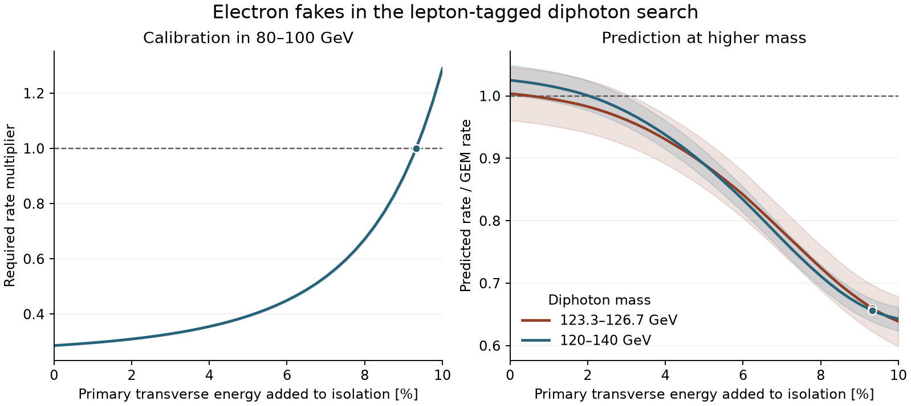

# Predicting the tagged electron-fake background from lower diphoton masses

GEM's electron-fake rates at 80, 90 and 100 GeV suffice to predict its 125 GeV result with a single rate multiplier. In 960,000 native PYTHIA 5.6 collisions, the multiplier is **0.2860 ± 0.0024** and the prediction in 123.3–126.7 GeV is **0.0375 ± 0.0016 fb**. Interpolation of GEM's 120 and 140 GeV entries gives **0.0374 fb**. The agreement extends to the wider 120–140 GeV interval. The quoted errors measure fluctuations across twelve independent simulation seeds. GEM published rounded densities and gave no statistical errors for this component. [GEM Table 19](https://lss.fnal.gov/archive/other/ssc/ssc-gem-tn-93-373.pdf#page=61) · [Calculation and uncertainties](control_fit.json)

## Comparing two explanations for the missing rate

The simulation uses the historical Zγ hard process and the [GEM-like isolation and identification cuts](../README.md). We vary the fraction of each primary electromagnetic object's transverse energy that reaches above-threshold cells outside its cluster and contributes to its isolation sum. A separate factor multiplies the selected eeγ rate. For each fixed leakage fraction we set the factor using only the published rates in 80–100 GeV. Integrating their linear interpolation gives 0.490 fb, compared with 1.713 ± 0.015 fb in the simulation at zero added leakage. In the last row of the comparison we instead set the multiplier to one and determine the leakage fraction from the same low-mass integral.

| Assumption used at 80–100 GeV | Rate multiplier | 100–120 GeV [fb] | 120–140 GeV [fb] | 123.3–126.7 GeV [fb] |
| --- | ---: | ---: | ---: | ---: |
| GEM, interpolated | | 0.310 | 0.200 | 0.0374 |
| Zero added leakage | 0.286 | 0.3186 ± 0.0044 | 0.2050 ± 0.0048 | 0.0375 ± 0.0016 |
| 2% added leakage | 0.310 | 0.3148 ± 0.0043 | 0.2001 ± 0.0048 | 0.0368 ± 0.0016 |
| 5% added leakage | 0.393 | 0.2974 ± 0.0046 | 0.1781 ± 0.0043 | 0.0333 ± 0.0014 |
| Leakage alone, fitted at 9.32% | 1 | 0.2462 ± 0.0040 | 0.1313 ± 0.0037 | 0.0247 ± 0.0014 |



Bands show one Monte Carlo standard error. The dots mark the solution obtained using leakage alone. The narrow Higgs window is part of the 120–140 GeV interval. Both comparisons use the same events. [Vector figure](mass-control.pdf)

The energy allowance in isolation is fixed at 5 GeV. As the primary transverse energy increases, a fixed leakage fraction consumes more of that allowance. A 9.32% fraction matches the low-mass yield but makes the predicted high-mass spectrum fall too steeply. Even allowing every GEM entry to vary by half its final printed digit, that model predicts only 62–71% of the published Higgs-window rate. A small contribution to isolation remains consistent with the spectrum if accompanied by an overall rate correction. For a check with a different hard process and shower, the modern full eeγ sample gives **0.0419 ± 0.0044 fb** in the Higgs window and **0.2014 ± 0.0097 fb** at 120–140 GeV when normalized to the same 0.490 fb. [Independent modern calculation](modern.json)

The two low-mass intervals also constrain the slope. Fitting both the multiplier and the leakage to their separate rates gives a leakage fraction of **(5.0 ± 2.1)%** and a multiplier of **0.395 ± 0.081**. This predicts **0.0332 ± 0.0038 fb** in the Higgs window. Varying the input densities across their published rounding intervals alone permits fitted leakage fractions from 0.5% to 6.6%. The finite precision of GEM's low-mass spectrum limits how well this fit can separate the two effects. [Two-parameter fit](control_fit.json)

## What can be learned about the fake electron

An approximately mass-independent suppression describes the discrepancy. Its interpretation as a detector efficiency requires an extra assumption. If the entire zero-leakage correction acts on the electron passing the photon tracking cut, the simulation's 90% conditional shower-identification efficiency becomes about **26%** (0.90 × 0.286). The nominal 3% chance of passing the tracker cut then gives a combined probability of about **0.77%** per candidate electron before the other event cuts. Other approximately mass-independent losses give the same rate test. A direct historical check would require counts of isolated electrons passing the photon tracking cut, then counts of how many of those also passed photon shower identification, ideally in bins of transverse momentum and pseudorapidity. Paired cone energies for these same probes would distinguish energy in the isolation cone from failure of shower identification. [GEM tracking study](https://lss.fnal.gov/archive/other/ssc/ssc-gem-tn-93-373.pdf#page=45) · [GEM shower identification](https://lss.fnal.gov/archive/other/ssc/ssc-gem-tn-93-373.pdf#page=19)

The mass intervals are comparisons with historical simulated rates. There are no SSC collision data. All fits keep reconstructed object momenta fixed, use the same leakage fraction for the genuine photon, fake photon and tag electron, and repeat both the calibration and prediction after omitting each seed in turn. Object-dependent shower fluctuations, mass migration, and correlations between tracking and calorimeter response could give a different result. The 125 GeV comparison uses neither of the high-mass GEM entries in the calibration. Using a linear interpolation of log density in place of density changes the fixed-model prediction relative to GEM by about 0.9% in that window. [Full interpolation and rounding checks](control_fit.json)

## Reproduction

From the repository root, Python and NumPy suffice to repeat the calibration with the archived per-seed rates. Matplotlib produces the figure.

```bash
audit=discovery/mass_scan/gem_range/lepton_tag/background_mc/zee_audit
control="$audit/selection/mass_control"
python3 "$control/control_fit.py"
python3 "$control/modern_check.py"
python3 "$control/plot_control.py"
```

To regenerate the per-seed grid from collisions, use the generator dependencies in the [native setup](../../README.md), including ROOT, gfortran and the archived PYTHIA 5.6 and JETSET 7.3 sources. The event replay also needs SciPy. It verifies the 80–140 GeV baseline and each previously calculated Higgs-window variation for every seed before writing the new rates.

```bash
work=$(mktemp -d)
bash "$audit/build_vintage.sh" "$work/generator" --mass-control
python3 "$control/replay_native.py" "$work/generator/vintage-mass-control" "$work/native_scan.json.gz" --workers 8
python3 "$control/control_fit.py" --native "$work/native_scan.json.gz" --output "$work/control_fit.json"
```
