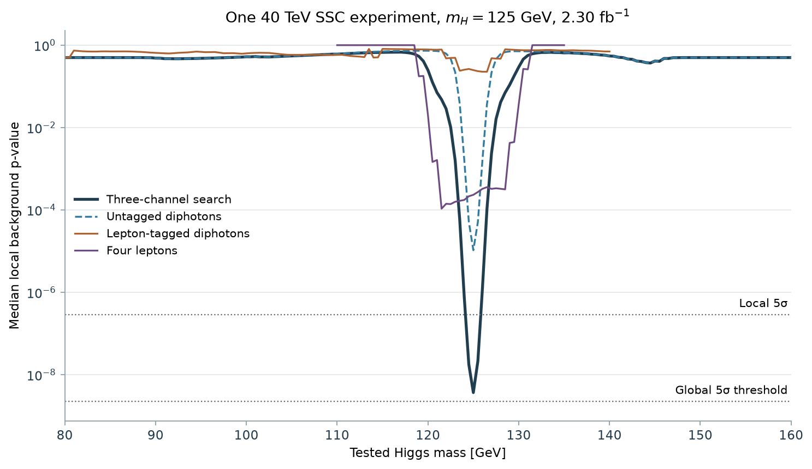

# Global discovery reach with two diphoton categories and four leptons

For a Standard Model Higgs boson of mass 125 GeV, one 40 TeV SSC experiment reaches a **50% probability of global 5σ at 2.30 fb⁻¹**, or **2.77 months** at the design rate of 10 fb⁻¹ per year. A **90% probability requires 3.86 fb⁻¹**, or **4.64 months**. Each probability applies at the specified exposure. The time conversion assumes design delivery from the start. [Numerical results](nominal.json)

| Search | 50% luminosity [fb⁻¹] | Design months | 90% luminosity [fb⁻¹] | Design months |
| --- | ---: | ---: | ---: | ---: |
| Two diphoton categories, global 5σ | 4.44 | 5.33 | 7.48 | 8.98 |
| Two diphoton categories and four leptons, global 5σ | **2.30** | **2.77** | **3.86** | **4.64** |
| Same three categories, local 5σ with the mass fixed at 125 GeV | 1.70 | 2.04 | 3.00 | 3.60 |

Adding four leptons reduces the median global discovery exposure by **48%**. At 125 GeV this channel contributes 1.67 fb of signal over 0.126 fb of continuum. The two diphoton rows use the same tagged and untagged inputs and the same photon search ranges. [Two-photon-category calculation](../lepton_tag/background_mc/final/combined-mc.json) · [Four-lepton mass distribution](../../fourlepton.json)



The global threshold marked on the plot applies to the combined search. Each curve gives the median at a specified mass. The discovery probability also counts simulated experiments whose most significant excess falls at a neighbouring mass. At the median exposure, the chance of crossing the global threshold at exactly 125 GeV is 47.2%. [Vector figure](local-p.pdf)

## What masses and backgrounds enter the calculation?

The fit tests one common mass every 0.5 GeV. The untagged diphoton category runs from 80 to 160 GeV and the lepton-tagged diphoton category from 80 to 140 GeV, following the endpoints of GEM's photon studies. The modern four-lepton selection contributes from 110 to 135 GeV. These limits keep each ±5 GeV window inside the 105–140 GeV classifier preselection. Beyond each channel's range the remaining channels determine the significance. The global false-positive rate covers these 161 hypotheses in a single experiment. [Photon categories and signal assignment](../lepton_tag/README.md) · [Four-lepton selection and scan](../../README.md)

The photon calculation uses the updated gluon-fusion normalization, simulated WH and ttH signals, and the sideband-calibrated inclusive background with its finite-simulation covariance. Lepton-tagged signal events are assigned first and the shared signal contribution is removed from the inclusive category. The tagged category uses the simulated continuum including electron and jet fakes. Four leptons enter as a statistically independent count with the central quark- and gluon-initiated continuum background. Across trial masses, overlapping mass windows share their events, and the untagged diphoton tests share the same bin fluctuations. [Tagged continuum and fakes](../lepton_tag/background_mc/README.md) · [Inclusive backgrounds](../projection/README.md)

At each mass the calculation combines a Gaussian diphoton score with two Poisson counts. It calibrates the probability of a background fluctuation passing anywhere on the grid by sampling experiments conditional on a crossing and weighting for the number of masses that cross. At the median exposure, a local 5.87σ excess gives global 5σ. An independent background sample gives a global probability of 2.866 × 10⁻⁷. Independent sets of 60,000 signal-injected experiments gave discovery probabilities of **49.81 ± 0.20%** and **90.04 ± 0.12%** at the reported exposures. The quoted errors are Monte Carlo standard errors in percentage points. [Scan](scan_three.py) · [Independent numerical checks](validation.json)

## Comparison with the GEM projection

GEM's June 1993 study plotted the luminosity required for a 5σ peak as a function of the assumed Higgs mass. At 125 GeV, the default solid curve gives approximately **2.7 fb⁻¹ (3.2 design months)**. Its dashed curve, with an alternative running bottom-quark mass in the Higgs calculation, gives approximately **1.5 fb⁻¹ (1.8 months)**. These values come from reading Figure 1. The table gives no channel breakdown at 125 GeV. At 120 GeV it lists 7.8σ in inclusive diphotons, 2.7σ in lepton-tagged diphotons, and 8.5σ combined at 10 fb⁻¹. The four-lepton entries begin at 140 GeV. [GEM Figure 1](https://lss.fnal.gov/archive/other/ssc/ssc-gem-tn-93-373.pdf#page=13) · [GEM Table 1](https://lss.fnal.gov/archive/other/ssc/ssc-gem-tn-93-373.pdf#page=12) · [Graph readings](legacy_figure.json)

Our median global exposure lies between the two GEM curves. GEM reported peak significance for each assumed mass and combined channel probabilities using its own prescription. The report discussed fluctuations across mass bins and did not publish a calibrated global 5σ probability for the full historical 80–800 GeV programme. The low-mass four-lepton analysis, updated rates and different discovery criteria prevent a direct percentage comparison of sensitivities. [GEM significance prescription, section 3.2](https://lss.fnal.gov/archive/other/ssc/ssc-gem-tn-93-373.pdf#page=32)

## Sensitivity to the reducible backgrounds

| Variation within the modern three-channel fit | 50% luminosity [fb⁻¹] | Design months | 90% luminosity [fb⁻¹] | Design months |
| --- | ---: | ---: | ---: | ---: |
| Modern simulated tagged background, 0.746 fb in the 125 GeV window | 2.30 | 2.77 | 3.86 | 4.64 |
| Scale just the eeγ background to GEM's normalization | 2.28 | 2.74 | 3.83 | 4.59 |
| Use GEM's full tagged background, 0.408 fb in the window | 2.26 | 2.71 | 3.78 | 4.54 |

The unresolved electron-to-photon fake rate changes the three-channel median by about 0.03 design months in this comparison. Both variations use the modern signals, the same four-lepton inputs and a fresh global calibration. [Electron-only variation](gem-electron.json) · [Full tagged-background variation](gem-total.json)

The larger background ambiguity comes from four-lepton heavy flavour. None of three million simulated heavy-flavour events passed the final selection. At the joint 95% simulation upper bound, the total background in the 125 GeV window rises to 0.671 fb. A conservative correction for all 161 masses gives **sufficient** exposures of **3.32 fb⁻¹ (3.99 months)** for 50% and **5.36 fb⁻¹ (6.43 months)** for 90%. This calculation uses power at the true mass alone and assumes valid background tests elsewhere on the grid. The heavy-flavour control provides an integrated bound and supplies no measured mass shape for a full alternative scan. [Conservative calculation](validation.json)

## Reproduction

From the repository root, run the following with Python, NumPy, SciPy and Matplotlib. The analysis reads the published spectra and covariance in this checkout. The central scan uses seed 923125 and 40,000 simulated experiments per final calibration.

```sh
dir=discovery/mass_scan/gem_range/three_channel
python3 "$dir/scan_three.py"
python3 "$dir/scan_three.py" --tag-background gem-electron
python3 "$dir/scan_three.py" --tag-background gem-total
python3 "$dir/validation.py" --scan "$dir/nominal.json"
python3 "$dir/plot_local.py"
```

To reproduce the historical graph reading, download the original GEM technical note and supply its PDF to the digitization script. This step also uses Pillow and Poppler's `pdftoppm`. The JSON records the PDF checksum, the tick positions and the stability of the reading under changes in the width of the mass interval. [Original GEM study](https://lss.fnal.gov/archive/other/ssc/ssc-gem-tn-93-373.pdf)

```sh
python3 "$dir/legacy_figure.py" /path/to/ssc-gem-tn-93-373.pdf
```
